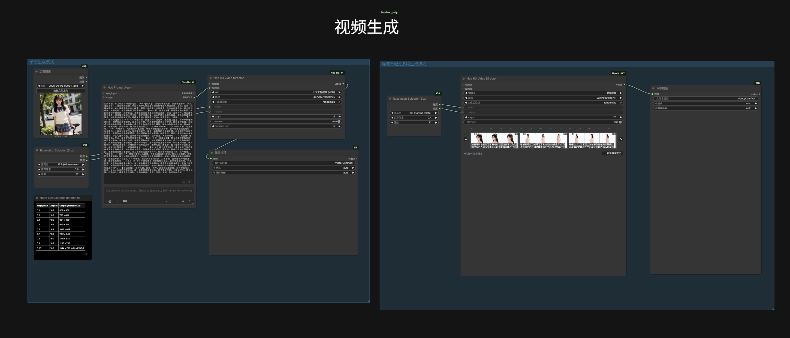

# Neo Studio

> 📄 English: [README_EN.md](README_EN.md)

**「一句话 → 提示词 → 成图 → 成片」**：提示词 AI 增强、生图与参考编辑、MiniMax H3 多段导演，全在一个插件里；
LLM 可在 ComfyUI 进程内零依赖运行。


**安装**：ComfyUI Manager 搜 `Neo Studio` 一键安装（已发布至 ComfyUI Registry），详见 [安装](#安装)。

## 为什么选 Neo Studio

| 能力 | 常见做法 | Neo Studio |
|------|----------|-----------|
| 本地 LLM | 需要 `llama-cpp-python`（Windows 上常编译失败） | **Native**：safetensors 文本生成模型在 ComfyUI 进程内推理，零额外依赖 |
| 云端 LLM | 手填端点与模型名 | 内置 DeepSeek / 阿里云百炼 / Kimi / 智谱 GLM / 硅基流动，填 Key 即用，🔌 测试连接当场验证 |
| 模型下载 | 手动下载再拖进模型目录 | ModelScope + Hugging Face 双源搜索，按仓库内路径自动归类落盘，断点续传 |
| 中文检索 | 只按英文 / 文件名匹配 | 中文技能名全拼 + 首字母缩写检索，LoRA 触发词拼音建议 |
| 生图 / 生视频 | 自己搭几十个节点 | 选技能即生成（技能自带 `workflow.json` 模板），H3 多段导演时间轴拖拽重排 |
| 换机器 / 改目录后 | 满屏红节点逐个改路径 | 顶栏 🅝「🔧 修复工作流」按文件名匹配磁盘真实文件一键修复 |
| 素材复用 | 手动 LoadImage 逐张挑 | 素材库灯箱 + ✈️ 一键写入指定节点，配方一键发送到画布 |

## 零配置可用（不配 LLM 也能用）

安装重启后即可直接使用，不需要任何模型或 API Key：

- **🖼️ Neo Gallery** — 素材浏览 / 灯箱 / 文件管理 / ✈️ 一键写入节点；Civitai LORA 匹配与收藏；LoRA 目录批量打标
- **🧊 Neo Recipes** — 提示词 + 素材保存为配方，一键发送到工作流（含导演配方编辑器）
- **🔧 工作流修复** — 模型路径失效时按文件名匹配磁盘真实文件一键修复
- **📥 模型库** — ModelScope / Hugging Face 双源搜索与断点续传下载（ModelScope 列表与搜索匿名可用）
- **🔲 Neo Reference Grid / 🧩 Neo Grid Split** — 参考图宫格管理、分镜宫格图自动切格
- **🧊 Neo Studio** — 独立页面（`neo-studio.bat` 或 `http://127.0.0.1:8188/neo-studio`；`neo-studio-app.bat` 是独立窗口版）：素材 / 导演 / 技能 / 设置

LLM 增强（✨ 生成 / 图片反推 / 翻译分类）是可选的第二步，三模式配置见 [docs/llm.md](docs/llm.md)。

## 模块一览

**节点**

- **📝 Neo Prompt Encoder** — 提示词管理 + AI 增强（预设 / 搜索 / LLM 增强），输出 CLIP 编码与文本
  → [prompts.md](docs/prompts.md)
- **⚡ Neo Prompt Agent** — 无需连 CLIP 的提示词生成，输出 PROMPT 文本与 BUNDLE 运行时包（可直接接 Krea2 / H3 视频节点）
  → [prompts.md](docs/prompts.md)
- **🖌️ 聊天生图** — 节点内置：选生图技能后 ✨ 直接生成（文生图 / 参考图编辑），实时进度与取消
  → [image-gen.md](docs/image-gen.md)
- **🎨 Neo Image Gen & Edit** — 按技能模板同步生成 / 参考编辑，直接输出 IMAGE 张量到下游
  → [image-gen.md](docs/image-gen.md)
- **🎞️ H3 Video Director** — MiniMax H3 视频生成：按 `video_director` 配方逐段生成并拼接为含音频 `VIDEO`
  → [h3-video-gen.md](docs/h3-video-gen.md)
- **📦 Neo Bundle Expand** — 把 BUNDLE 展开成 `prompt` + `image_1..9`，对齐官方 H3 Reference to Video
  → [prompts.md](docs/prompts.md)
- **🔲 Neo Reference Grid** — 单节点管理「提示词 + 最多 12 张参考图」，宫格参与配方保存与还原
  → [prompts.md](docs/prompts.md)
- **🧩 Neo Grid Split** — 分镜宫格图自动切格，行优先拼成 `IMAGE` 批次并带出原图内嵌提示词
  → [h3-video-gen.md](docs/h3-video-gen.md)

**面板与入口**

- **🖼️ Neo Gallery** — 侧边栏素材浏览与管理：预设 / 自定义目录 / Civitai LORA、灯箱、LoRA 打标
  → [gallery.md](docs/gallery.md)
- **⭐ 收藏（书签）** — 本地收藏（路径记录）+ Civitai 收藏（边下边开）
  → [gallery.md](docs/gallery.md)
- **🧊 Neo Recipes** — 侧边栏配方（提示词 + 图片 / 视频 / 音频资源）管理与一键发送
  → [recipes.md](docs/recipes.md)
- **🅝 顶栏菜单** — 插件统一入口（悬停约 0.3 秒或点击展开，指针离开自动收起）：新影工坊 / 生成素材 / 新建导演配方 / 创建节点（新节点落在当前可见区的空白处）/ 修复工作流 / 回写入技能 / 设置 / 模型库 / 技能管理
  → [workflow-repair.md](docs/workflow-repair.md)
- **🗂 技能管理** — 技能详情页（设置区 + 提示词 + 工作流区）：工作流区直接内嵌编辑 `workflow.json`，
  「⤒ 导入到画布」/「💾 回写入技能」，
  落盘前弹变更确认并记本机变更历史；预设只读，复制为自定义后可编辑
  → [skills.md](docs/skills.md)
- **🔧 工作流修复** — 模型路径失效时按文件名匹配磁盘真实文件一键修复，可手动改选与记住映射
  → [workflow-repair.md](docs/workflow-repair.md)
- **📥 模型库** — Comfy-Org 专区双源（ModelScope / Hugging Face）搜索与断点续传下载，按仓库内路径自动归类落盘
  → [model-hub.md](docs/model-hub.md)

节点外观：




## 功能演示

主要模块的交互实录（点击缩略图进入对应文档）：

- [](docs/h3-video-gen.md)
  — 🎞️ H3 Video Director · 时间轴重排
- [](docs/recipes.md) — 🧊 Neo Recipes · 一键发送

## 目录

- [为什么选 Neo Studio](#为什么选-neo-studio)
- [零配置可用](#零配置可用不配-llm-也能用)
- [模块一览](#模块一览)
- [功能演示](#功能演示)
- [安装](#安装)
- [依赖](#依赖)
- [快速上手](#快速上手)
- [示例工作流](#示例工作流)
- [基础概念](#基础概念)
- [模块文档](#模块文档)
- [许可证](#许可证)
- [引用参考](#引用参考)
- [开发者文档](#开发者文档)

## 安装

- **ComfyUI Manager（推荐）**：在 Manager 中搜索 `Neo Studio` 一键安装（已发布至 ComfyUI Registry）
- **comfy CLI**：`comfy node install comfyui-neo-studio`
- **源码安装**：`tools\install_plugin.ps1` 把代码与内置预设装进 `ComfyUI/custom_nodes/comfyui-neo-studio`，
  并写好数据根指针 `configs/data_root.json`（用户数据留在 `Neo-Studio/data`，卸载只删插件目录）

```powershell
pwsh -NoProfile -ExecutionPolicy Bypass -File tools\install_plugin.ps1 -ComfyUI D:\ComfyUI -DataRoot D:\Neo-Studio\data
```

- **手动克隆**：把本仓库克隆成 `ComfyUI/custom_nodes/comfyui-neo-studio`，重启 ComfyUI

```bash
git clone https://github.com/neoneo-ai/Neo-Studio.git ComfyUI/custom_nodes/comfyui-neo-studio
```

- **桌面版**：`tools\build_studio_exe.ps1` 出 `tools\neo-studio.exe`（单文件）或 `-Mode onedir` 目录版；
  发布开关 `-Sign`（signtool）/ `-Notarize`（macOS notarytool）/ `-Publish`（comfy node publish）默认不执行

> **从旧版升级**：包名从 `comfyui-neo-nodes` 换成 `comfyui-neo-studio`。先删掉
> `ComfyUI/custom_nodes/ComfyUI-Neo-Nodes` 再装新包——两个目录同时存在会把同一批节点注册两遍。
> 用户数据不在插件目录里，删旧目录不动数据。

## 依赖

- `openai`、`PyYAML`、`pypinyin`、`Pillow`（随 `requirements.txt` 自动安装；Pillow 由 ComfyUI 核心自带）
- 可选增强（缺包时对应功能自行降级）：`laya`（智能 skill 选择）、`pillow-heif`（HEIC 读取）、
  `oss2`（Backyard OSS 上传）
- `llama_cpp_python`（**可选**，仅 Local GGUF 本地推理需要，见 [docs/llm.md](docs/llm.md)；原生引擎与远程 API 可跳过）

---

## 快速上手

1. **安装**：ComfyUI Manager 搜 `Neo Studio` 一键安装（或见上方手动安装），重启 ComfyUI。
2. **先玩零配置功能**（不需要 LLM 与任何模型配置）
   - **素材一键入节点**：右侧边栏「素材」面板 → 浏览 / 搜索到目标图片 → 点缩略图进灯箱
     → 点 ✈️ Send 选择目标节点（LoadImage 类优先）→ 图片直接写入该节点。
   - **模型库下载**：顶栏 🅝「📥 模型库」→ 选源（ModelScope / Hugging Face）→ 搜索 → 选文件
     → 自动带出落盘类别与子目录 → ⬇ 下载，可断点续传。
   - **工作流路径修复**：换机器 / 改目录后模型路径失效时，点顶栏 🅝「🔧 修复工作流」
     → 确认框核对候选新路径（可手动改选、可调匹配阈值）→ 点「修复」原地更新画布。
3. **配置 LLM（三选一，✨ 增强 / 图片反推 / 翻译分类需要）**
   - **原生**：把 safetensors 文本生成模型（如 `qwen3.5_4b_bf16.safetensors`）放入 `models/text_encoders/`，
     Settings → Provider 选「Native (ComfyUI safetensors)」并选择模型后点 💾 保存，在 ComfyUI 进程内直接推理，
     无需额外依赖。说明见 [docs/llm.md](docs/llm.md)。
   - **远程**：节点 Settings 里选 Provider（内置 DeepSeek、阿里云百炼、Kimi、智谱 GLM、硅基流动，
     以及 OpenAI 兼容 / LM Studio / Ollama / OpenRouter 等），填 API Key 与端点；
     表单底部「🔌 测试连接」用当前填写值发送「你好」验证连通（无需先保存）。
     各家端点与申请入口见 [docs/llm.md](docs/llm.md)。
   - **本地**：把 GGUF 模型放入 `models/LLM/`，Settings → Provider 选「Local GGUF」并选择模型后点 💾 保存
     （目录只有一个模型时可跳过，运行时自动使用）。安装与目录规范见 [docs/llm.md](docs/llm.md)。
4. **第一次提示词增强**：添加 ⚡ Neo Prompt Agent 节点 → 在底部快捷输入框写一句简短描述 → 点 ✨
   → 得到 AI 生成的提示词文本（无需连 CLIP，可直接接下游如 🎨 Krea2）。
5. **第一次生图**：添加 🎨 Neo Image Gen & Edit 节点 → 选一个带 `workflow.json` 的生图技能
   → prompt 接 ⚡ Neo Prompt Agent 或手填，参考编辑类再连参考图槽位 → 排队执行 → 直接输出 IMAGE 张量。

   > 生图需 GPU / 显存，且所选技能必须声明 `gen_image: true` 并附 `workflow.json`。
   > 生图模型 / Text Encoder / VAE 默认「自动」按技能模板匹配，未匹配到时再手动指定。

6. **第一次多段视频**：添加 🎞️ H3 Video Director 节点 → 选 `video_director` 配方
   → 时间轴拖拽重排 / 单段重生成 → 逐段生成并拼接为单个含音频 `VIDEO`。

---

## 新影工坊（Neo Studio · 独立应用）

不依赖画布的独立页面：运行插件目录下 `neo-studio.bat`（自动拉起 ComfyUI），
或手动启动后打开 `http://127.0.0.1:8188/neo-studio`。含四个页签：

- **素材**：完整 Neo Gallery（浏览 / 灯箱 / 文件管理）
- **导演**：配方列表（只列多段导演配方）+ 导演编辑器（与画布内一致）+ 整片生成面板
  （带进度 / 取消；只读时间轴上勾选段块后只生成勾选的段，采样中实时预览，成片自动记进配方「结果」区）
- **技能**：统一技能管理（与顶栏「🗂 技能管理」同组件，左列表 + 右详情直接展开）
- **设置**：生图 / 生视频 / LLM 设置 / 日志（ComfyUI 控制台）

依赖画布的功能（如「发送到节点」）在 Studio 内自动降级为提示。

想要独立窗口（不占浏览器标签页），双击 `neo-studio-app.vbs`：同一个页面跑在 WebView2 窗口里，
没有控制台黑窗，窗口大小位置会记住（最小化时保存的屏幕外位置自动丢弃，回退默认），设置与素材库状态在重开后保留。需要 `pywebview`（`pip install pywebview`），
Windows 自带 WebView2 Runtime 即可。ComfyUI 的后台日志在「设置 → 日志」里看，壳自己的启动过程、每次整页
跳转与页面的未捕获错误都落在 `tmp/studio_shell.log`（只留尾部 200KB）；`neo-studio-app.bat` 是带控制台的
调试入口（加 `--debug` 会开 DevTools）。壳自带一个离线服务
（`neo_studio_server.py`，跑在 ComfyUI 端口 +3，默认 `8191`）：ComfyUI 没在跑时窗口直接开在 Studio 上，
素材浏览 / 技能编辑 / 配方编辑 / 设置（含 LLM 配置）/ 模型库 / 收藏 / LoRA 打标照常可用（哪些接口归壳服务由
`neo_studio_caps.py` 一张表划定），顶栏出「ComfyUI 未运行」横幅和「🚀 启动 ComfyUI」按钮；生成 / 队列 / 显存
这类需要 ComfyUI 运行时的请求由壳回 `409 offline`（不假装成功），前端提示「需要 ComfyUI」并把运行按钮
（生成素材 / 生成整片 / 生成这一段 / 拼回成片 / 生成图片分镜）直接变成启动入口。壳拉起 ComfyUI 的这段时间
（`starting` 由壳侧 `/neo_studio/version` 与 `comfy_state` 共用同一份标记，页面第一份状态就是启动中）
界面只出「ComfyUI 启动中…」，未运行横幅、启动按钮与「需要 ComfyUI」提示一律收起；
ComfyUI 就绪后窗口整页跳到 `http://127.0.0.1:8188/neo-studio`
的完整 Studio，停掉 ComfyUI 后窗口再拉回离线 Studio，不用对着空白窗口干等。窗口先出：起解释器查依赖、
装配壳侧服务、拉起 ComfyUI 都在后台线程走完，窗口先停在启动页（根目录与解释器没定时停在「首次设置」页），
跑完才整页跳过去 —— 双击到看见窗口之间只剩解包与建窗口。壳是启动器：关窗时窗口先出
「正在停止 ComfyUI…」，壳自己拉起的 ComfyUI 收掉之后窗口才关（收尾不在 UI 线程上做，窗口不会冻成卡死；
关窗事件没走到，也会在壳进程退出前收掉），用户自己启动的那路不动（没有句柄就不碰，避免误杀，也不出这句提示）。
端口上已有 ComfyUI 在监听就直接附着（认端口，不认 Neo 专属路由：那路插件没加载也认），绝不另起第二路；
单实例锁是命名互斥体，不占端口，netstat 里壳只占自己的素材服务端口。
顶栏是一枚把动作写在脸上的启停按钮，旁边一枚 PID 徽标：运行中「■ 停止内核」，已停止「▶ 启动内核」，
壳拉起后端口未就绪期间「🚀 启动中…」（禁用）；按钮本体一个色，红色只落在停止图标上。徽标报进程号
（`# PID: 4321`，没有进程时徽标不出现），端口 / 谁启动 / 就绪收在按钮提示里。点停止内核即退出（壳拉起的直接 `terminate()`，并按端口找监听者 PID 一并终止），
点启动内核重新拉起，就绪后窗口自动跳回完整 Studio；窗口留着。

窗口与任务栏图标是拍板造型的
`web/neo-studio.ico`（`tools/make_studio_icon.py` 生成）。要 Explorer 与快捷方式也显示同款图标，用
`tools\build_studio_exe.ps1` 打包单文件启动器 `tools/neo-studio.exe`（构建期依赖 pyinstaller，
产物是本地产物，不进 Registry 分发）。`-Mode onedir` 出目录版 `tools/neo-studio/Neo-Studio.exe`（exe 加 `_internal`
整包一起拷走，启动不解包，出窗口比单文件快 0.7s 上下，状态目录是包旁的 `data/`）；`-Mode both` 两个都出，按分发场景挑。
**改完 `neo_studio_app.py` 必须重新打包**：直接双击 exe 测试的人只认这个包，源码改了包没改等于没修。技能里的「⤒ 主画布编辑」与顶栏「🎬 新影工坊」都在这个窗口里跳转：
前者在壳窗口内加载主界面灌画布，后者从主界面回到 Studio，不弹浏览器标签页（Studio 页内状态随整页跳转丢失，
设置与素材库状态保留）。Studio 顶栏的「🎬 新影工坊」标题本身就是回主画布的链接；主画布是整页刷新，
壳在每次页面加载后往左上角重新挂一枚「🎬 返回 Studio」胶囊（Studio 页不挂），点它由壳直接跳回 Studio。
`/neo-studio` 带 `Cache-Control: no-cache`、插件静态文件带 `no-store`，改过的顶栏与 JS 在壳窗口里立刻生效；
开窗口前壳还会清掉 WebView2 的 HTTP 缓存 —— 缓存里的旧插件 JS 会和新拉到的模块拼成同一张 ES 模块图，
一个链接错误就让整页只剩顶栏（视图不挂、顶栏启停控件也不出现）。

打包后的 exe 是便携启动器：放在 `<根目录>/custom_nodes/comfyui-neo-studio/tools` 下时，ComfyUI 根目录与
python 都从 exe 自身位置往上推导（找带 `main.py` 的那一级），双击即启动；根目录推导不出、或同级与内部
都找不到 `python/python.exe` 时，窗口开在「首次设置」页补齐这两项 —— 原生目录/文件选择器加实时校验
（根目录要有 `main.py`、解释器要真是文件），点「开始」写配置并拉起 ComfyUI；两项都自动找到了就直接进
Studio，不显示这一页。「启动设置」标签页（只在壳窗口里出现：快照走壳的 js_api，浏览器标签页没有桥就没有这一页）改
ComfyUI 根目录、python 解释器与端口，两行路径都带原生「浏览…」选择器，保存前由壳校验（根目录必须真有 `main.py`，否则拒绝，免得点了启动
内核才发现起不来），配置落在壳侧状态目录的 `launcher_config.json`（插件目录不可写时退回 `%APPDATA%/NeoStudio`）。
exe 内置一份插件副本（只含 git 已跟踪的文件，用户配置与密钥不进包），`custom_nodes` 里缺插件时开窗口前自动装
过去，依赖照 `requirements.txt` 一起带上；内置副本的版本比已装的那份新时覆盖更新，`configs/`、`skills/`、
`recipes/`、`prompts/`、`gallery/` 这些用户数据整目录带进新副本，源码运行（开发模式）与 git 检出的那份不碰；
ComfyUI 正在跑时插件目录被占用，本轮跳过、下次启动再更新。「启动设置」面板显示自检状态，缺依赖时给「安装依赖」、插件安装失败
时给「重试安装插件」。

---

## 示例工作流

`example_workflows/` 下提供可直接加载的 UI 格式模板，ComfyUI 会自动将它们暴露在顶栏
**Templates（模板）** 面板中，选择后一键载入画布。

## 基础概念

### skill

技能不只是提示词模板，还包含内置模型配置（model / vae / clip）、内置工作流与默认基础参数。
技能列表可进入详情页查看；系统预设不可编辑，复制为自定义后即可编辑。

### bundle

包含运行时需要的参数：提示词和图片（可选）。

### recipe

- **基础配方**：把当前的提示词和图片资源保存下来，便于复用。
- **导演配方**：支持多段连续生成，由导演台编辑生成并保存，director 节点运行时选择对应配方，
  点击节点上的 timeline 可直接进入编辑。故事板分镜页支持主题 / 脚本一键 LLM 生成分段分镜
  （角色参考图锁身份），也支持宫格图自动拆分（各格作分段首帧）与逐格 LLM 描述提示词。

### model

技能内置了模型；若想常改，可直接接入外部 `model` 与 `lora`，覆盖技能内置的主模型配置。

---

## 模块文档

各功能模块的详细文档已按模块拆分到 `docs/` 目录（索引见 [docs/README.md](docs/README.md)）：

| 文档 | 内容 |
|------|------|
| [docs/prompts.md](docs/prompts.md) | 提示词节点、界面按钮、图片反推 |
| [docs/skills.md](docs/skills.md) | 技能管理：管理窗口、工作流区编辑、画布导入与回写 |
| [docs/llm.md](docs/llm.md) | LLM 模式、云供应商、原生 safetensors 引擎、本地 GGUF 安装与目录规范 |
| [docs/image-gen.md](docs/image-gen.md) | 生图：聊天生图、Image Gen & Edit、尺寸与扩图 |
| [docs/h3-video-gen.md](docs/h3-video-gen.md) | 生视频：导演配方执行、单段重生成、宫格拆分 |
| [docs/recipes.md](docs/recipes.md) | 配方：保存、发送到工作流、导演配方编辑器 |
| [docs/gallery.md](docs/gallery.md) | 素材库：浏览、灯箱、文件管理、Civitai LORA、收藏 |
| [docs/workflow-repair.md](docs/workflow-repair.md) | 工作流模型路径修复 |
| [docs/model-hub.md](docs/model-hub.md) | 模型库：双源搜索、自动归类落盘、断点续传下载 |

---

## 许可证

SPDX-License-Identifier: Apache-2.0

---

## 引用参考

collections portrait 10000+ 精美提示词来源：

[civitai.com/models/2231696](https://civitai.com/models/2231696)

---

## 开发者文档

开发相关内容（项目结构、后端模块、API 路由、节点注册、测试等）见 [Developer.md](Developer.md)。

## 版本变更记录

每个发布版本的改动清单见 [CHANGELOG.md](CHANGELOG.md)（随标签发布至 ComfyUI Registry）。
