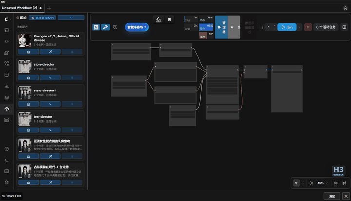
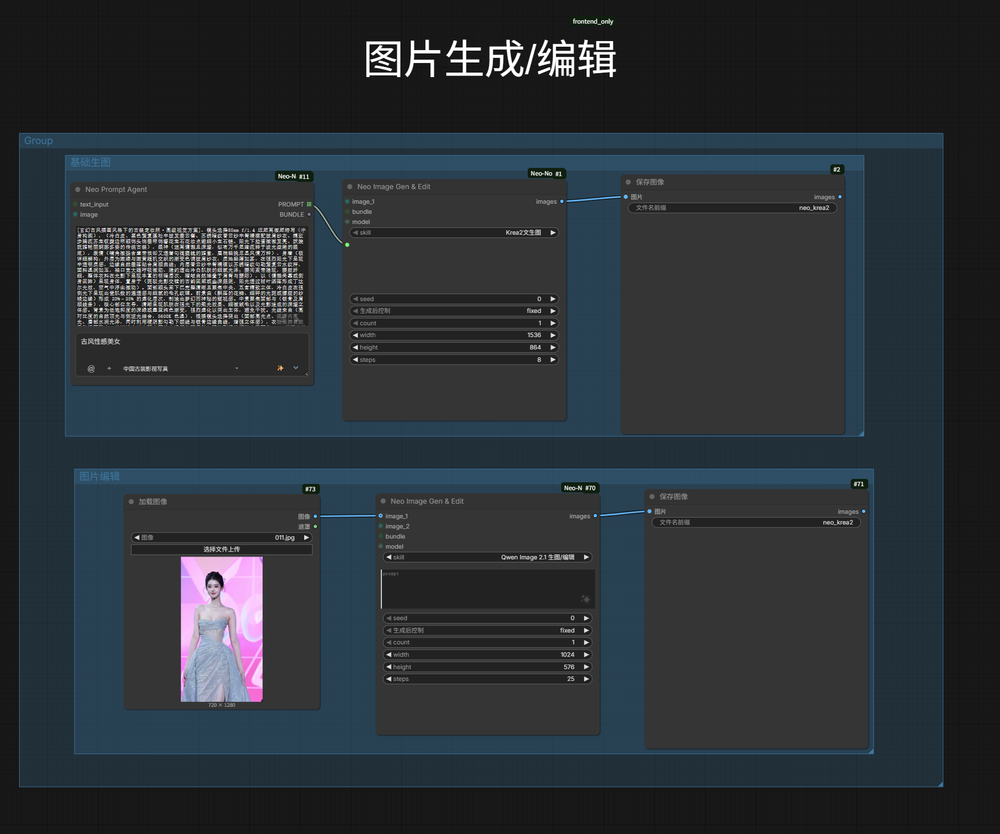
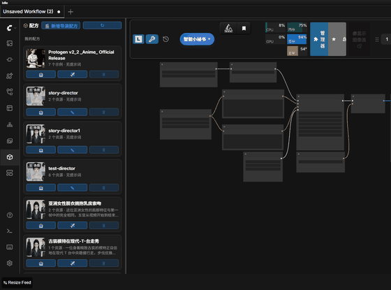

# Neo Studio

> 🇨🇳 中文: [README_ZH.md](README_ZH.md)

**From one sentence to prompt, image, and film**: AI prompt enhancement, image generation and reference editing,
and MiniMax H3 multi-segment video direction — all in one plugin. The LLM can run inside the ComfyUI process
with zero extra dependencies.



**Install**: search `Neo Studio` in ComfyUI Manager (published to the ComfyUI Registry), see [Installation](#installation).

## Why Neo Studio

| Capability | Usual approach | Neo Studio |
|------------|----------------|-----------|
| Local LLM | Needs `llama-cpp-python` (often fails to build on Windows) | **Native**: safetensors text-generation models run inside the ComfyUI process, no extra dependency |
| Cloud LLM | Fill endpoint and model name by hand | Built-in DeepSeek, Alibaba Cloud Bailian, Kimi, Zhipu GLM, SiliconFlow — add an API key and go; 🔌 Test Connection verifies live |
| Model downloads | Download manually, then drag files into folders | ModelScope + Hugging Face dual-source search, files land in the right model folder by repo path, resumable downloads |
| Chinese input | English / filename matching only | Chinese skill names searchable by full pinyin and initials; pinyin LoRA trigger-word suggestions |
| Image / video generation | Wire up dozens of nodes | Pick a skill and generate (skills ship a `workflow.json` template); H3 multi-segment director with drag-and-reorder timeline |
| After moving machines | Red nodes everywhere, fix paths one by one | 🅝 menu → "Repair Workflow" matches broken paths against real files on disk in one click |
| Asset reuse | Pick images one by one with LoadImage | Gallery lightbox + ✈️ one-click write into a target node; recipes send to canvas in one click |

## Works without an LLM

Available right after install and restart, with no model or API key configured:

- **🖼️ Neo Gallery** — asset browsing, lightbox, file management, ✈️ one-click send to node; Civitai LoRA matching and bookmarks; batch LoRA tagging
- **🧊 Neo Recipes** — save prompt + media as a recipe, one-click send to workflow (with director recipe editor)
- **🔧 Workflow Repair** — one-click fix for broken model paths
- **📥 Model Hub** — ModelScope / Hugging Face dual-source search with resumable downloads (ModelScope listing and search work anonymously)
- **🔲 Neo Reference Grid / 🧩 Neo Grid Split** — reference-image grid management, automatic storyboard grid splitting
- **🧊 Neo Studio** — standalone page (`neo-studio.bat` or `http://127.0.0.1:8188/neo-studio`; `neo-studio-app.bat` opens it in its own window): Assets, Director, Skills, Settings

LLM enhancement (✨ generate / image captioning / translate & classify) is the optional second step;
the three modes are documented in [docs/en/llm.md](docs/en/llm.md).

## Features

| Module | Type | Description |
|--------|------|-------------|
| Neo Prompt Encoder | Node | Prompt management + AI enhancement; CONDITIONING + text for txt2img → [prompts.md](docs/en/prompts.md) |
| Neo Prompt Agent | Node | Prompt generation without CLIP; PROMPT text + BUNDLE → [prompts.md](docs/en/prompts.md) |
| Neo Image Gen & Edit | Node | Skill-template generation / reference editing; IMAGE output → [image-gen.md](docs/en/image-gen.md) |
| H3 Video Director | Node | MiniMax H3 multi-segment video with native audio; drag-reorder timeline → [h3-video-gen.md](docs/en/h3-video-gen.md) |
| Neo Bundle Expand | Node | BUNDLE → `prompt` + `image_1..9` for official H3 Reference-to-Video → [prompts.md](docs/en/prompts.md) |
| Neo Reference Grid | Node | Prompt + up to 12 reference images in one grid node → [prompts.md](docs/en/prompts.md) |
| Neo Grid Split | Node | Storyboard grid → IMAGE batch + embedded prompt → [h3-video-gen.md](docs/en/h3-video-gen.md) |
| Neo Gallery | Sidebar | Asset browser, lightbox, send-to-node, Civitai LoRA, LoRA tagging → [gallery.md](docs/en/gallery.md) |
| Bookmarks | Asset panel | Local bookmarks + Civitai bookmarks (download-on-open) → [gallery.md](docs/en/gallery.md) |
| Neo Recipes | Sidebar | Recipe management with one-click send to workflow → [recipes.md](docs/en/recipes.md) |
| Workflow Repair | Menu item | One-click fix for broken model paths → [workflow-repair.md](docs/en/workflow-repair.md) |
| Model Hub | Menu item | Dual-source repo search, category placement, resumable downloads → [model-hub.md](docs/en/model-hub.md) |
| Skill Management | Menu item | Inline workflow editing, canvas import & writeback, change preview + history → [skills.md](docs/en/skills.md) |
| MCP Server | Standalone process | Claude Desktop / Cursor calling image & director tools over stdio → [mcp.md](docs/en/mcp.md) |

Node appearance:



## Demo

Interaction recordings (click a thumbnail to open the matching doc):

- [](docs/en/h3-video-gen.md)
  — 🎞️ H3 Video Director · timeline reorder
- [](docs/en/recipes.md) — 🧊 Neo Recipes · one-click send

## Installation

**Neo Studio App is the recommended form.** It is the Studio window (Assets / Director / Skills /
Settings), it starts and stops ComfyUI from its own settings page, and it puts the plugin into
`custom_nodes` by itself — you never touch the plugin folder. It needs a ComfyUI install with its
Python interpreter; it does not bundle ComfyUI.

- **Portable app** — a single file, `Neo-Studio-<version>-windows-x64.exe`, attached to
  [GitHub Releases](https://github.com/neoneo-ai/neo-studio/releases) by
  `.github/workflows/release-app.yml` (built by `tools\build_studio_exe.ps1`, unsigned — expect a
  SmartScreen prompt on first run). It derives the ComfyUI root and the interpreter from its
  own location, opens a first-setup page when it cannot find them, and installs or updates the
  plugin from its bundled copy — user data dirs are carried over, a git checkout is never touched.
- **From source** — clone the repo and run `tools/neo-studio-app.vbs` (no console window;
  `tools/neo-studio-app.bat` is the debug entry, `--debug` opens DevTools). Every launch syncs
  `studio/` into `custom_nodes` (same-name files only, nothing in the target is deleted).

The window, the offline service and the kernel controls:
[Neo Studio (Standalone App)](#neo-studio-standalone-app).

<details>
<summary>ComfyUI plugin form — the nodes inside ComfyUI's own UI, without the Studio window</summary>

- **ComfyUI Manager**: search `Neo Studio` and install.
- **comfy CLI**: `comfy node install comfyui-neo-studio`
- **Manual**: clone into `ComfyUI/custom_nodes/`, then restart ComfyUI:

```bash
git clone https://github.com/neoneo-ai/neo-studio.git ComfyUI/custom_nodes/comfyui-neo-studio
```

The clone form runs on the repo root `__init__.py`, which hands node and route registration to
`studio/`; the installed package (Registry, Manager, `tools/install_plugin.ps1`, desktop sync) has
`studio/__init__.py` at its own root and never goes through it.

Source install: `tools/install_plugin.ps1` installs the code and the built-in presets and writes the
`configs/data_root.json` data-root pointer (user data lives outside the plugin dir, so uninstalling
is just deleting the plugin dir). Commands, parameters and release switches:
[docs/en/release.md](docs/en/release.md).

> **Upgrading from the old package**: the Registry package moved from `comfyui-neo-nodes` to
> `comfyui-neo-studio`. Delete `ComfyUI/custom_nodes/ComfyUI-Neo-Nodes` before installing the new one —
> keeping both directories registers the same nodes twice. User data does not live in the plugin
> directory, so removing the old folder touches no data.

</details>

## Dependencies

- `openai`, `PyYAML`, `pypinyin`, `Pillow` (auto-installed via `requirements.txt`; Pillow ships with ComfyUI core)
- Optional extras (features degrade gracefully when a package is missing): `laya` (smart skill picking),
  `pillow-heif` (HEIC reading), `oss2` (Backyard OSS upload)
- `llama_cpp_python` (**optional**, only for local LLM inference)

## Quick Start

1. **Open Neo Studio** (the app) — it installs the plugin and starts ComfyUI for you. Plugin-only
   users: install it and restart ComfyUI.
2. **Zero-config features first** (no LLM, no model setup needed): ✈️ send an asset from the Gallery
   lightbox into a LoadImage-type node ([gallery.md](docs/en/gallery.md)), download models from the Model
   Hub with automatic category placement ([model-hub.md](docs/en/model-hub.md)), repair broken workflow
   paths from the 🅝 menu ([workflow-repair.md](docs/en/workflow-repair.md)).
3. **Configure an LLM** — pick one; needed for ✨ enhancement, image captioning and translate/classify:
   *Native* (safetensors in `models/text_encoders/`, runs inside the ComfyUI process, zero extra
   dependency), *Remote* (provider + API key, "🔌 Test Connection" verifies live) or *Local* (GGUF in
   `models/LLM/`). Setup, endpoints and GGUF rules: [docs/en/llm.md](docs/en/llm.md).
4. **First prompt**: add a **Neo Prompt Agent** node → type a short description → click ✨ → AI-generated
   prompt text (no CLIP needed).
5. **First image**: add a **Neo Image Gen & Edit** node → pick an image-gen skill → prompt (from the Agent
   or manual) + optional reference images → queue → IMAGE output. Needs a GPU / VRAM, and the skill must
   declare `gen_image: true` and ship a `workflow.json`; model / Text Encoder / VAE default to "Auto".
6. **First multi-segment video**: add a **H3 Video Director** node → pick a `video_director` recipe → drag
   to reorder segments / regenerate a single segment → stitched into one `VIDEO` with audio.

## Key Concepts

- **Skill**: A bundled template containing model config (model/VAE/CLIP), workflow, and default parameters. Preset skills are read-only; copy to customize.
- **Bundle**: Runtime payload — prompt text + optional reference images.
- **Recipe**: Saved prompt + media assets for reuse. *Director recipes* support multi-segment video generation with a timeline editor.

## Neo Studio (Standalone App)

Canvas-independent page with four tabs: **Assets** (the full Gallery), **Director** (director recipes + editor +
full-film generation with progress, cancel and live preview), **Skills**, **Settings** (image / video / LLM /
ComfyUI log). Canvas-only actions show a hint instead of failing.

| Entry | What it does |
|-------|--------------|
| `neo-studio.bat` | Opens `http://127.0.0.1:8188/neo-studio` in the browser, and starts ComfyUI for you |
| `neo-studio-app.vbs` | The same page in its own WebView2 window — no console, no browser tab; window geometry and Studio state survive restarts (needs `pywebview`; the WebView2 Runtime ships with Windows) |
| `neo-studio-app.bat` | Console/debug entry for the same window (`--debug` opens DevTools) |
| `tools/neo-studio.exe` | Packaged launcher with the clapperboard icon — built by `tools\build_studio_exe.ps1` ([release.md](docs/en/release.md)) |

- **Offline service** — `app/studio_server.py` on ComfyUI port + 3 (`8191` by default) keeps browsing, skill /
  recipe editing, settings (LLM included), Model Hub, bookmarks and LoRA tagging working while ComfyUI is down.
  Anything that needs the ComfyUI runtime answers `409 offline`, the UI says "needs ComfyUI", and the generate
  buttons become start buttons.
- **The header only reports state** — "● Running" / "● Stopped" / "● Starting", with the port, the PID and who
  launched it in the tooltip. The actions live at the top of Settings → 启动设置: one state line plus
  "▶ Start kernel" and "■ Stop kernel", the one that cannot run right now disabled.
- **The window opens first** — the dependency self-check, the service setup and the ComfyUI spawn run on a
  background thread behind a splash page; once the port answers, the page connects generation in place — no
  navigation, no reload — and stopping ComfyUI flips it back to the offline Studio.
- **Closing the window** stops the ComfyUI the desktop started (one you started yourself is left alone); a ComfyUI
  already listening on the port is attached to, never doubled.
- **Canvas jumps stay in the window** — "⤒ 主画布编辑" and "🎬 新影工坊" switch in place, and the desktop
  re-injects a "🎬 返回 Studio" pill on every non-Studio page.
- ComfyUI's log is under Settings → Log; the desktop's own trace (startup, page jumps, window drags) goes to
  `data/studio_desktop.log`.

Frameless window, window & taskbar icon, exe packaging, portable launcher and the source sync:
[Developer_EN.md](Developer_EN.md).

## Documentation

Full index with a one-line summary of every module doc: [docs/en/README.md](docs/en/README.md).

## Changelog & License

Version history: [CHANGELOG.md](CHANGELOG.md). SPDX-License-Identifier: Apache-2.0

10000+ portrait prompt collection source: [civitai.com/models/2231696](https://civitai.com/models/2231696)

## Developer Docs

Project structure, backend modules, API routes, node registration, tests, and the Studio desktop internals
(offline service, capability table, drag loop, launcher config): [Developer_EN.md](Developer_EN.md).
