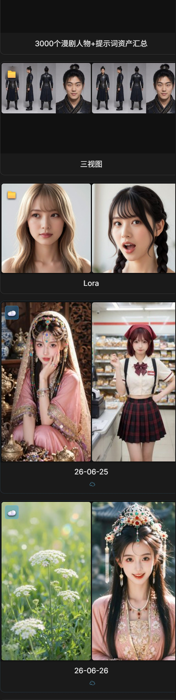
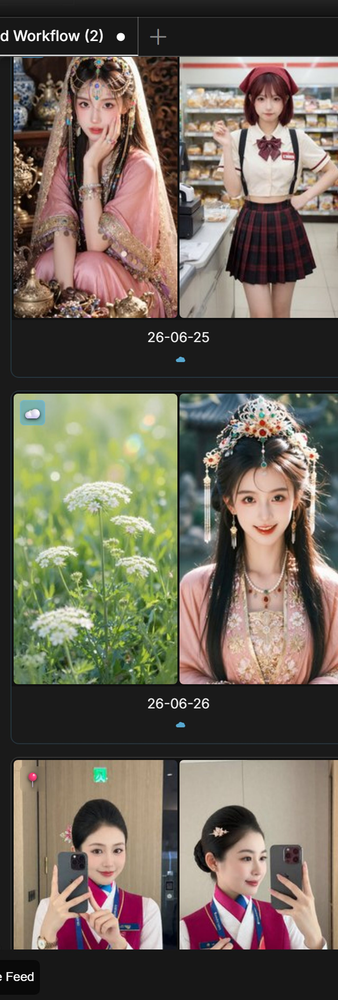
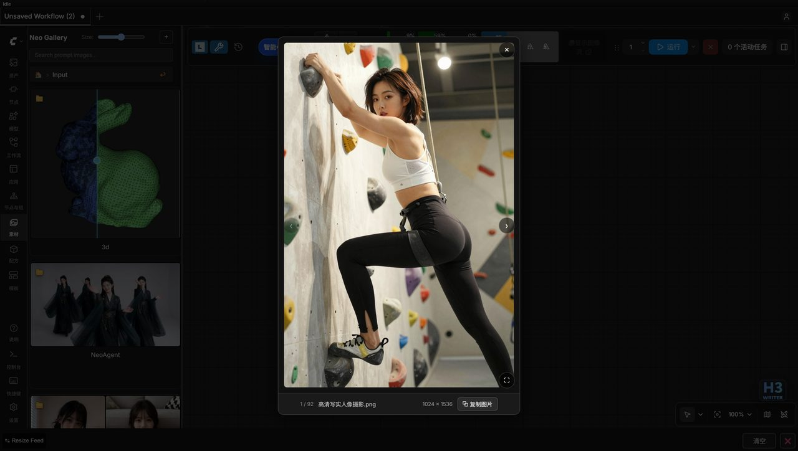

# Neo Gallery - Sidebar Asset System

> 🇨🇳 中文: [../gallery.md](../gallery.md)

An image / video / audio browsing and management panel in ComfyUI's right sidebar: a built-in preset
library plus several user-defined directories.

## Browsing & navigation

- **Sidebar integration** - opens as a right-sidebar tab, no need to leave the canvas.
- **Breadcrumb navigation** - clear hierarchy across nested subdirectories, one click back to the parent.
- **Forward / back** - next to the header title, move forward and back along your browsing trail (the browser
  Back follows the same trail; Alt+Left / Backspace go to the parent directory).
- **Sort by time** - sorted by file modification time, newest/oldest order switchable and remembered.
- **Scroll position memory** - the browsing position of every directory is saved and restored in place when
  you return.
- **Lazy loading** - the list renders in pages and covers load only when they scroll into view, so even large
  libraries stay smooth.

### Card layout

#### Arrangement rules

- Cards are packed in a masonry layout (each entry goes into the currently shortest column), so mixed heights
  fill the gaps and no column is left blank.
- Inside one directory, subdirectory cards and image cards share a single masonry flow (directory cards first,
  then image boxes filling the gaps) with no hole at the seam.
- Asset thumbnail cards adapt their height to the image orientation: portrait → tall 3:4 card, landscape →
  short wide 3:2 card, square → square card.
- A directory card takes its height from the composite ratio of its cover tiles, naturally different from a
  single-image card; a cover of the same orientation fills its tiles exactly, with no cropping.

#### Covers & cropping

- At most two cover images: portrait / square images sit side by side anchored at the top (less head cutting),
  a landscape image keeps only one.
- A pure-audio directory shows audio tiles; an empty or stale cover shows a generic placeholder tile.
- A portrait image inside a card (height ≥ width) is anchored at the top, cropping the bottom instead of the
  head.

## Media & search

- **Images, video and audio** - mixed browsing of images (jpg / png / webp / gif …), video (mp4 / webm …) and
  audio (wav / mp3 / m4a / flac / ogg …); audio cards show a waveform and ▶ plays a preview (the first playback
  decodes the real peaks).
- **Thumbnail cache** - thumbnails are generated on first visit and appear instantly afterwards.
- **Card ratio cache** - image width/height are read from the file header and stored under
  path+mtime+size in `configs/gallery_dim_cache.json`, so reopening a directory (even after a restart) stops
  reading images one by one — very visible on network drives.
- **Keyword search** - searches file names and the contents of same-named `.txt` description files across
  directories.
- **Drag onto nodes** - drag a card onto a LoadImage / Load Video / LoadAudio node on the canvas to fill it
  (the file is copied into the input directory automatically), and the target node highlights on a hit; an
  image card can also be dropped on the "grid split" node to fill its filename input. A payload type that does
  not match the target node is not written.

### Generate assets

"🖼️ Generate assets" next to the search box opens a small window (like the director recipe window: no
background overlay, title bar drags the window) that creates new assets from a prompt alone.

#### Skill & parameters

- **Skill** - Krea2 text-to-image by default; other pure text-to-image skills can be selected and the last
  choice is remembered.
- **Ad-hoc parameters** - temporarily pick the main model / LoRA / aspect ratio / longest side (like wiring a
  model onto a node; nothing is written back to the global settings). A combination you like can be saved as a
  new skill in one click: the name is generated from the main model name + LoRA name, the ratio and longest
  side are stored as chosen, and every other setting follows the current skill.

#### Enhancement & history

- **✨ Enhance** - an agent-style enhancement area (output box on top, quick input below, mirroring the
  NeoPromptAgent node): type a description or an editing instruction in the quick input, pick an enhancement
  skill (only image-enhancement skills are listed, auto-routing by default, last choice remembered) and click
  ✨ for streaming enhancement. It reuses the node's agent logic (the selected skill's skill.md as system
  prompt + reference files read on demand), writes the answer into the output box, and shows the reasoning /
  pipeline state in a temporary panel above the output. On success the quick input clears, and when a prompt
  already exists the new instruction is appended after a separator.
- **History** - the quick input and the output each keep their own terminal-style ↑/↓ history (persisted in
  localStorage): the quick input remembers the inputs you used, the output remembers the final prompts that
  were actually generated.

#### Generation & products

- **Generate** - uses the output box as the final prompt (falling back to the quick input when empty);
  products land in `Output/NeoAgent/<date>/`, and after success you can jump straight to the landed directory,
  or delete the result images in one click when you do not like them.
- **Helper buttons** - 🎲 fills in a random entry (sampled from the mixed pool); ▾ runtime random settings
  (when enabled, "Generate" becomes a batch that samples N entries and generates them one by one, cancelling
  keeps what was already generated, and recipes are not part of the pool); ☰ the preset list (search, click to
  fill the output box, with no recipe entries).
- The quick input's placeholder rotates through usage hints as it gains focus.

## Lightbox viewer

Click a thumbnail to open full-screen viewing with wheel zoom and drag panning, neighbor preloading and size
display; the prompt sidebar on the right shows the image's prompt and parameters (hidden when there is nothing
to show, and hidden automatically when entering full screen). The sample results in recipe details share this
same lightbox component.

| Button | Function |
|------|------|
| ⧉ Copy | Copy the current image to the clipboard |

The sidebar offers: prompt / parameters copied section by section, 🔍 reverse-prompt (calls the LLM on the
current image, with progress state while it works), and ⤷ Import workflow (available when the media carries an
embedded ComfyUI workflow).

## File management

### File operations

- **Delete** - deletes media files in the library directly; the built-in presets library is read-only
  protection against accidental deletion.
- **Multi-select batch delete** - a checkbox in the top-left of asset cards enables multi-select (Ctrl+A selects
  the current view, Esc clears); the bottom action bar's "Delete" removes only the checked items after a
  confirmation; presets / lora / Civitai bookmarks / remote OSS sources show no checkbox and cannot be deleted.
  The action bar also has "New director recipe": it takes the checked images one by one as each segment's first
  frame and builds an f2v recipe.
- **LoRA tagging** - the ⋯ button in the top-right of a writable leaf image directory (Input / custom
  directories) opens the tagging dialog, generating a `.txt` tag file per image for the whole directory; its
  parameters and flow are under "🏷️ LoRA tagging".

### Directory management

- **One ordering table** - the "Manage Directories" dialog lists the built-in sections (Output / Input / local
  bookmarks / Civitai bookmarks / Lora), custom directories and the cloud preset directories (row label prefixed with
  ☁) in a single table, where the ⠿ handle
  on a full row reorders the home-page cards; 👁 on each row hides / restores it (a hidden one is not listed in
  the library, and a hidden cloud preset directory answers its deep link with nothing), custom rows additionally
  have ✕ to remove (removed from the list only, no disk file is
  deleted); the row buttons (⚙ / 👁 / ✕) appear only while hovering that row.
- **⟳ Refresh index** - a title-bar button that force re-downloads the cloud preset index
  (`POST /neo_gallery/sync_oss`): directories published in the cloud show up on the home page and in this table at
  once, without waiting for the local index cache to expire; the success toast reports the directory and item counts,
  a failure reports the backend reason.
- **⚙ on the Lora / Civitai bookmark rows** - the Civitai settings area (API KEY / proxy / sync directory
  picker) is hidden by default; clicking ⚙ on those rows expands it on the **right side** of the dialog, and
  clicking again collapses it; on the bookmark row, expanding focuses the API KEY box.
- **Multi-source aggregation** - one unified entry browses every directory without interference.

### Output root directories

- **StoryBoard / CharacterSheet roots** - the browsable output subdirectories `output/StoryBoard/` and
  `output/CharacterSheet/`. They show no card on the home page and are entered through the "go to" entries in
  the generation-result area / asset card menu, or through a deep link; generated character sheets and
  storyboards land in a `<date>/` subdirectory.
  - Each level's cards use that level's own first two media as the cover (image > video > audio priority).
  - Inside, a read-only **Cloud Presets** entry exists (remote preset cache under `presets/<remote dir>/`), and
    `Grid/presets/**`, `Character/presets/**` are undeletable just like Cloud Presets.
- **Recently updated first** - inside the three directories the plugin writes itself (generated `Output`, the
  archived `Grid` / `Character`), every level's subdirectory cards put the newest write first, and covers take
  the newest two within the same type (image > video > audio priority); other directories keep their original
  order and cover selection.

## Image card "⋯" menu actions

### Character sheets & storyboards

- **Generate character sheet (multi-view)** - opens a small window (the same dialog as the nine-cell storyboard,
  references shown at card size plus a name confirmation); after "Generate" it shows queue / generation
  progress live inside the window, previews the result when done (click for the original) and offers "open
  output directory". It uses Qwen Image 2.1 with that portrait as reference to produce a four-view character
  sheet (head close-up / front / side / back) in one click, requested at 1920×1080 (size aligned to 16), landing
  in `output/CharacterSheet/<date>/`; existing same-named files are skipped, and the result can be dragged
  straight into a director recipe's 👤 character references.
- **New director recipe** - creates an f2v director recipe with that image as the first frame and opens the
  editor (5 seconds per segment by default). An image inside a subfolder is first copied to the `input/` root
  (deduplicated by content hash).
- **Generate storyboard grid** - opens a small window: a **storyboard story** box on top (writable by hand), a
  **grid skill** dropdown in the middle (`storyboard_grid_6` by default), and a **brief story / idea** box at
  the bottom (may stay empty).
  - "✨ LLM generate storyboard story" hands only the brief story (or just the cell count when empty) to the
    selected grid skill, streaming a story that advances cell by cell across N cells and overwriting the story
    box above, which stays editable. This step does not give the images to the LLM: it first extracts the
    reference person's appearance and clothing into text and hands that to the writer together with the brief
    story.
  - After "Generate" the window stays open: it shows a queue / generation progress bar inside (with "cancel
    task") and previews the result in place when done. Before generating, one constrained vision call runs on
    the reference image (only 1-2 sentences of appearance + clothing) and is injected into the prompt as a text
    anchor, then Qwen Image 2.1 generates the N-cell storyboard with that image as reference following the
    selected grid skill (4 = 2×2, 6 = 2×3, 9 = 3×3, each cell about 16:9), landing in
    `output/StoryBoard/<date>/`.
  - Dragging that grid image into the director editor's "🧩 grid storyboard split" cuts it into N keyframes in
    row-major order (one shot per cell, thin white separators, no text inside cells).

### Image editing

Opens a small window (image on top, controls below: source / result comparison area + an editing skill dropdown
and an editing instruction box). Qwen Image 2.1 is used by default and any other `image_gen` skill can be
selected; the source is passed as a reference image, you type the editing instruction and click "Generate".

- **Curtain comparison** - the result appears in place as a "source | result" curtain comparison (the divider
  starts at the left edge, so you see the whole result first). A drag counts as curtain dragging only after
  moving past a short threshold (6px): pressing on the source image / the divider handle and dragging moves the
  divider with the pointer; a press that never reaches the threshold counts as a click, not a drag.
- **View large** - clicking the image (press and release, no drag) opens the lightbox, and the curtain decides
  which image you get: a click right of the divider shows the edit result, one left of it shows the source
  (divider at the left edge = the whole picture is the result, at the right edge = the whole source); clicking
  the divider handle itself always shows the source. The lightbox list is source + references + edit result
  (←/→ to page); the "🔍 view large" button to the right of the comparison labels works in every mode, and in
  outpaint mode clicking the empty area of the drag box follows the same curtain rule. In masked / click modes
  a click paints or marks, so only the button works there.
- **Target resolution** - the source size by default, aligned to a multiple of 32, capped proportionally by the
  "model working resolution" when it exceeds it (1.5MP by default); after generation the comparison window's
  left side becomes that scaled image too, since pixel-by-pixel alignment needs both sides the same size. Size
  details: [image-gen.md](image-gen.md).
- **Custom parameters** - a collapse row at the end of the "target resolution" row: expand it to pick the main
  model / LoRAs for this run (the same control as in the generate-material popup, nothing is written back to the
  global settings). Empty = follow this skill's `config.json` and the global image-gen settings, and switching
  skills or the outpaint / masked / pose switches replays that skill's model and LoRAs. Aspect ratio and max
  side are not exposed here - the output size follows the source (the "target resolution" row above).
- **Outpaint** - a switch in the window that automatically selects the "Qwen Image 2.1 outpaint" skill. Drag a
  box on the source to set the padding on the four sides (dragging the box pans it and redistributes the
  padding; expansion only outward, with free / 1:1 / 16:9 / 2.35:1 and similar ratio presets; when the canvas
  exceeds the visible area everything scales down proportionally, with the side length capped at 4× the source).
  The padding follows your drag faithfully, with nothing padded on an axis you never dragged. Target megapixels
  default to 1.5 and the label shows the output size; an empty prompt is prefilled with the default trigger
  words.
- **Click-to-remove** - a switch in the window that runs Qwen Image 2.1 editing on the source: click directly on
  the source to mark the object to remove (up to 5 points; clicking an existing marker clears that point, "clear
  markers" resets all). After marking, SAM3 performs point-prompt segmentation automatically (needs a sam3
  checkpoint in `models/checkpoints`, e.g. `sam3.1_multiplex_fp16.safetensors`) and overlays the mask in red on
  the source for preview; on confirmation the high-resolution local-edit pipeline removes it, output at the
  source size. The prompt box is prefilled with the default removal instruction (visible and editable; when left
  empty the backend supplies the same default).
- **Pose editing** - a switch in the window that automatically selects the "Qwen Image 2.1 pose editing" skill,
  with the prompt prefilled by the default pose trigger words (replace the pose description inside the brackets
  with the action you want). With only the source attached it changes that person's pose following the prompt;
  dropping a second image into the reference area (a person photo or a skeleton image) transfers its pose onto
  the source's person, and the prompt then swaps to the pose-transfer trigger words (removing that reference
  swaps back; a prompt you wrote yourself is never overwritten). Both usages keep the source's face, hair,
  clothing, lighting and background, and the output size follows regular editing (target resolution from the
  source size).
- **ControlNet structure lock** - "Qwen Image 2.1 ControlNet" in the editing skill dropdown (no dedicated
  switch, selecting the skill is enough): the source goes into `<image1>` supplying content and face, and a
  second image dropped into the reference area (a person photo or a skeleton image) goes only into the
  ControlNet model patch to produce an Openpose skeleton, locking pose and composition (it never reaches the
  encoder, so it is not reproduced as a content reference); `<image3>` onwards serve as extra content references
  such as clothing or style. With fewer than 2 references the backend reports "this skill needs at least 2
  reference images". Details: [image-gen.md](image-gen.md).

### LoRA card metadata

The "⋯" menu of a Lora directory example card shows that LoRA's safetensors header metadata below "📤 Send
Lora": a `base_model` badge and a `dtype` badge (each shown only when it has a value), plus a trigger-word area
(shown when non-empty) — click a word chip to copy that word, "copy all" writes every trigger word joined by
", " to the clipboard. The metadata comes from the cache directory's `_meta.json` (see "Civitai LORA example
cache").

## Asset settings

The "Settings" button at the top of the sidebar manages custom directories; these display settings live in the
ComfyUI settings panel:

| Setting | Type | Default | Description |
|------|------|--------|------|
| Neo Gallery Max Thumbnail Size | slider (150-500) | 320 | Maximum thumbnail size (pixels) |
| Neo Gallery Display Image Labels | toggle | true | Show image name labels |

## Civitai LORA example cache (fetched automatically on visit)

The **Civitai LORA Examples** area at the bottom of the "Manage Directories" dialog pulls LORA example images
and prompts from Civitai (civitai.com) into the asset library. No manual sync is needed: opening the "Lora"
directory puts every uncached LORA into a background fetch queue.

### Fetch settings

- **Enable Civitai LORA** (master switch, off by default) - when off, no Civitai LORA example is registered,
  shown or fetched, and the home page's Lora section (including cached directory cards) disappears; only when
  ticked does it fetch automatically for the selected directories. The switch state lives in
  `configs/gallery_settings.json`.
- **Civitai API KEY** - paste your civitai.com API key and click "Save API KEY"; the key is stored on this
  machine only (`gallery_settings.json`, never in the library) and is displayed masked afterwards. Without a
  key, the selected LORA directories still appear in the asset panel with a "API KEY required" badge, but
  nothing is fetched over the network.
- **Test Civitai connectivity** - Civitai has network requirements (most environments need a proxy). Clicking it
  requests `GET /me` (up to 20 seconds) and reports whether it is reachable and whether the stored key is
  accepted (showing your Civitai username on success), separating "cannot reach Civitai (proxy needed)" from
  "API KEY rejected HTTP 401/403". When the fetch queue hits an unreachable state it aborts the current batch
  early and says so in the status bar.
- **Proxy** - with the "proxy" field empty, the plugin uses the Windows system proxy (if a browser can reach
  Civitai, this works; when the proxy port is not listening it falls back to a direct connection). When your
  proxy client is not in system-proxy mode (TUN, for example) or you need a specific proxy, enter an address
  like `127.0.0.1:7890` and save.
- **Select LORA Directories** - lists the first-level subdirectories under `models/loras` (with counts,
  multi-select), and selecting saves immediately; the home page's Lora area **shows only** the LORA examples
  under the selected directories, and unselected loras never appear in the asset panel. A selected directory
  that no longer exists under `models/loras` is ignored outright, with no status card.

### Cache & usage

- **Cached on access** - opening the "Lora" directory or its subdirectories queries Civitai
  (`model-versions/by-hash`) by file SHA256, downloads every example image of that version in the background and
  writes a prompt sidecar; at most 20 LORAs are processed per visit, cached ones (unchanged size/mtime) are
  skipped, and the cache of deleted or replaced LORAs is cleaned automatically. Failed items show a red badge
  and can be requeued with "Retry Failed".
- **Cache directory** - results land in `gallery/lora_cache/` (a read-only asset source, same mechanism as
  presets): **one LORA = one directory**, containing several `example_NN` images plus same-named `.txt` files
  (the example prompts).
- **Header metadata** - while fetching, the safetensors header is read too (weights are never loaded) and the
  base model, trigger words and precision are written into that directory's `_meta.json`, with the compact
  fields backfilled into `_index.json`; the list page shows badges from it, so you do not have to open each
  cache directory. Header strings are display-only and are never used as paths or network addresses. Civitai's
  `trainedWords` are merged with the header trigger words and deduplicated.
- **Directory metadata refresh** - "🔄 Refresh metadata" in a Lora directory card's "⋯" menu re-reads the
  safetensors header of every LORA in that directory and updates the badge fields of `_meta.json` and
  `_index.json`; purely local, no network, no example re-download, and merged Civitai trigger words are kept.
- **Send to canvas** - the asset panel shows the "Lora" directory with every capability available (browsing,
  search, lightbox); clicking 📤 on a Lora thumbnail, in the lightbox, or on the directory card sends that
  LORA's relative path (e.g. `detail/tweak.safetensors`) into the `lora_name` parameter of a standard
  `LoraLoader` on the canvas (target menu: the selected node wins, several targets open a dropdown).
- **Context-aware filter** - inside the "Lora" area, ticking "used by the workflow" shows only the LORA
  directories currently used by `LoraLoader` nodes on the canvas (matched by `lora_name`).

## ⭐ Bookmarks

The asset panel's home page has **Local bookmarks** and **Civitai bookmarks** entry cards, and the bookmark
backend is unified in `bookmark.py` (`bookmarks.json` records local bookmarks as path information only, copying
no files).

### Bookmark entries

- **Extra actions button** - the "⋯" in the bottom-right of any asset thumbnail opens the bookmark menu:
  **Bookmark this image** (records the asset's full path) or **Bookmark its directory** (adds the whole
  directory to bookmarks, custom directories and OSS preset assets included). Bookmark cards and directory cards
  share the same cover rendering (at most two, taken from the first two thumbnails of the bookmarked content;
  pure audio shows an audio tile).

### Local bookmarks

- Opening "Local bookmarks" on the home page enters the bookmarks section; clicking a card locates and opens the
  source directory by the recorded path (with a notice when the source was moved or deleted), and ✖ removes the
  bookmark at any time.

### Civitai bookmarks

- "Civitai bookmarks" on the home page lists the models you bookmarked on civitai.com (paged browsing, original
  ratio covers, at most two).
- **Browse while downloading**: opening a bookmarked model lets you browse as soon as the first example image
  arrives, while the rest keep caching in the background and the directory completes itself.
- **Enable Civitai bookmarks** (on by default): the switch sits in the Civitai (C-sync) area of the "Manage
  Directories" dialog; when off, the home entry and the `Civitai bookmarks` directory stop loading (the home
  page redraws immediately after the switch).
- Same as the Lora section: thumbnail grid, lightbox (←/→ paging, zoom, full screen), and saving a bookmark as
  a recipe.

## 🏷️ LoRA tagging (batch directory tagging)

**🏷️ LoRA tagging** in a directory card's "⋯" menu sends every image of a directory to a vision LLM in batch
and writes a same-named `.txt` per image (for LoRA training).

### Dialog & parameters

- **Trigger word** - the dialog prefills a suggested trigger word generated from the directory name (the ASCII
  part is sanitized, a Chinese directory name falls back to the name itself) and you can change it; the trigger
  word is forced to the front of the tags, and tags are always separated by ", ".
- **Reuses the LLM configuration** - it uses the vision model and prompt template from the LLM settings (the
  `tagging` template in `configs/llm.json`, with the `{trigger_word}` / `{standardize}` placeholders); when no
  vision model is configured the dialog errors out immediately.
- **Auto standardize** - optionally backs up the whole directory to `<dir>.bak` first, then converts HEIC→PNG
  with sequential names `001.png`…, moving the same-named `.txt` along (HEIC conversion needs the optional
  `pillow-heif`).
- **Skip tagged** - images that already have a same-named `.txt` are skipped, filling only the gaps.
- **Standard description switch** - when ticked, the model is asked for standardized tag descriptions.

### Execution & abort

- **No overlay, draggable** - like the director editor, the tagging window has no overlay; the title bar drags,
  double-click maximizes/restores, and you can keep browsing the gallery and working on the canvas while it runs.
- **Abort any time** - during tagging, "cancel" becomes "abort tagging", and ✕ / Esc / abort all drop the
  requests; the backend stops after the current image finishes, the `.txt` files already written stay, and the
  untagged ones are not processed.
- **Result summary** - tagging streams progress over SSE (local GGUF / remote API reuse the existing LLM), and
  on completion it reports the success count and the file names of the failures; one failed image does not affect
  the rest.

## Implementation notes (developers)

The backend tagging lives in `lora_tag.py`. Tags generated earlier can be reformatted offline with
`python tools/format_tags.py <dir> [--trigger <word>] [--dry-run]`, which reorders every tag with ", ", splits
the trigger word out of the first tag and puts it on its own at the front, and backs the original `.txt` files
up to `<dir>.txtbak`.

Backend implementation: [architecture.md](architecture.md) (`gallery.py` / `gallery_lora.py` /
`gallery_oss.py` / `lora_tag.py`), API: [api-routes.md](api-routes.md).
