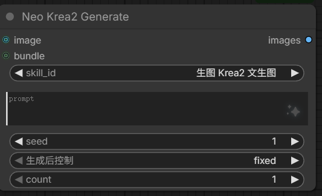

# Krea2 Image Generation

> 🇨🇳 中文: [../image-gen.md](../image-gen.md)

Image generation has two entry points: the **chat generation** built into the prompt nodes, and the
standalone **🎨 Neo Image Gen & Edit** node (text-to-image + reference editing, the model decided by the
selected skill, e.g. Krea2 / Qwen Image 2.1).

## Chat generation (built into the node)

- Pick an image-generation skill and click ✨ to generate straight away: text-to-image / reference
  editing, LoRA optional.
- The bottom status line shows live progress and cancel; the result is previewed as Markdown, and can be
  assembled back into a LoadImage in one click.
- Generation needs GPU / VRAM, and the selected skill must declare `gen_image: true` and ship a
  `workflow.json`.
- The generation model / Text Encoder / VAE default to "auto", matched against the skill template, so
  nothing has to be configured by hand; only when nothing matches do you name them in the image
  generation settings.
- Every entry in the model dropdowns carries the model file's update date
  (`qwen_image_2.1_int8_convrot · 2026-09-12`), so a file that was just dropped into the model directory is
  easy to spot; entries whose file time cannot be read (a dropped network share, a file moved right after the
  listing) carry no date and the list itself is unaffected.

## 🎨 Neo Image Gen & Edit - all-in-one generation / editing node (IMAGE output)

**Generates an image synchronously from the selected skill's `workflow.json` template and outputs the
IMAGE tensor directly** for downstream wiring.

- No reference attached = text-to-image; attach references and the skill template switches to reference /
  editing mode (e.g. Qwen Image 2.1 editing, up to 10).
- Unlike chat generation: it does not go through the chat interface and does not write into the `output`
  directory — the image is returned to the workflow as a tensor.
- Inside the node's `execute` it runs the skill template topologically, skipping the SaveImage / Preview
  and other writing nodes, and takes the terminal IMAGE output.
- Needs GPU / VRAM: `execute` loads UNET + CLIP + VAE and samples, blocking the main workflow while it runs.



**Usual pairing ⚡ Neo Prompt Agent**: it generates the prompt text that feeds this node.

### Skill dropdown

- Listed by the image-generation skills' **Chinese names** (frontmatter `cn_name`, falling back to `name`),
  and only the image-generation skills that ship a `workflow.json`.
- Inside the node the selected name is resolved back to the skill id before the template is taken, so ids
  and names stored in older workflows keep working; after adding, removing or renaming skills, refresh
  `/object_info`.
- Clicking the dropdown opens a centered searchable picker (grouped by category, 📷 marks skills that need
  images, skill-management entries at the bottom) instead of the native combo list.

### Inputs / Outputs

| Input | Type | Description |
|------|------|------|
| `skill` | COMBO | Image-generation skill name (displays `cn_name`, resolved to the id internally) |
| `prompt` | STRING | Prompt (typed by hand, or wired from a Neo Prompt PROMPT) |
| `refs.image_1 … image_10` | IMAGE (Autogrow, optional) | Reference slots: none = text-to-image, attached = reference / editing |
| `bundle` | STRING (optional) | The BUNDLE id from Neo Prompt Agent; a plain connection slot in the UI |
| `seed` | INT (optional) | Random seed, default 0 (fixed) |
| `count` | INT (optional) | Number of images (1–8), default 1 |
| `width` / `height` | INT (optional) | Output size, `-1` = compute it from the skill's preset ratio |
| `steps` | INT (optional) | Sampling steps, `-1` = the skill's `config.json` `steps` (default 20) |
| `model` | MODEL (optional) | External accelerator model; when supplied it overrides the internal main model chain |

| Output | Type | Description |
|------|------|------|
| `images` | IMAGE | Generated image tensor `[B,H,W,C]` |

- Reference slot order is the semantic order; how many are kept follows the skill's `config.json`
  `max_refs` (falling back to the number of `{{REF_IMAGE_n}}` slots in the template), and references
  beyond the template slots auto-fill by extending the chain of the highest existing slot (a
  single-chain Krea2 template takes only the first and says so).
- With `bundle` connected: an empty `prompt` takes the one inside the bundle, the bundle's references win
  over the ones attached to the node, and only the `prompt` widget is disabled while `skill` stays
  selectable; a missing or expired bundle falls back to the local inputs.
- Image-generation skills always use the node's local selection (a bundle carries prompt and references,
  never the skill).
- Selecting or switching a skill makes the frontend fill in that skill's preset size and step count; your
  own edits take precedence.
- For a random seed, set "post-generation control" to randomize.

### Behavior

- **Automatic fix for shifted legacy workflows**: a "post-generation control" dropdown is appended after
  `seed` and occupies one `widgets_values` slot. After the widget set changes, loading an old workflow or
  copy-pasting can shift every value by one position; when the frontend detects that "post-generation
  control" is not a mode string, it resets it to `fixed`, puts `count` back to 1, refills the size from
  the selected skill's preset, and resets `seed` to 0 when it is not a finite number or is negative.
- **Skill validity bar**: the bottom of the node validates the selected skill's `workflow.json` in the
  background (against `/object_info` and `/models/*`); when models or nodes are missing it shows
  "⚠️ N models missing · M nodes not installed → details / fix", and the button opens that skill's detail
  dialog for fixing. The bar hides entirely when nothing is missing, when there is no `workflow.json`, or
  when the validation endpoint is unavailable; a skill's result is cached for 60s within the session.

## Size (Qwen Image 2.1)

One Qwen Image 2.1 latent cell = 32px (VAE 16x downsampling + 2x2 patchify).

- **Target size is forced onto the 32 grid**: requests that run the Qwen 2.1 template align explicit
  width/height to 32 first, and the ratio / default path aligns once more as a backstop. The gallery's
  image-edit dialog defaults the target resolution to the source size, aligned to 32.
- **Model working resolution** = the `target_megapixels` setting (default 1.5, under "⚙️ Settings → 🖼️
  Image generation defaults → Target megapixels", overridable by the skill's `config.json`): the outpaint
  padding canvas is normalized to it, and an editing target above it is capped proportionally to it
  (capping only, never enlarging).
- **Regular editing** (with references, not outpaint, not masked local editing): the reference and the
  latent must share the size and sit on the same 32 grid, otherwise the content shifts:

```
LoadImage → ImageScale(canvas width/height) → TextEncodeQwenImage21(resolution=0) → KSampler
Empty latent: EmptyLatentImage(target width/height)
```

- **Canvas size**: when the ratio matches the source it is simply the target resolution; when the
  difference exceeds half a cell (a re-render in a new aspect) the source is only aligned to 32, never
  stretched into a distorted reference. Without a reference (text-to-image) this node is pruned together
  with its `LoadImage`, and the latent comes from the template's `EmptyLatentImage`.
- The gallery's comparison window swaps its left side for this scaled image (the backend returns it as
  `canvas` with the job): both sides must be the same size for pixel-by-pixel alignment.

## Pose editing (Qwen Image 2.1)

Preset skill `qwen_image_21_pose_edit`: with one reference it changes `<image1>`'s pose following the
prompt; with a second reference it moves `<image2>`'s pose onto `<image1>`'s person, keeping the face,
clothing and background. The default trigger words come from that skill's `config.json` `default_prompt`
and are prefilled as soon as the skill is picked. No extra LoRA is required; drop a pose-transfer LoRA
into `models/loras` and add it to that skill's `config.json` `loras`.

The gallery's "Image edit" dialog has a "🕺 Pose" switch (see [gallery.md](gallery.md)) that runs this
skill: the source goes into `<image1>` scaled to the canvas size, and the images dropped into the
reference area fill `<image2>` and the slots after it in order; dropping a pose reference swaps the prompt
to the transfer trigger words (swapping back when it is removed, and never overwriting a prompt you wrote
yourself); target resolution, curtain comparison and the rest match regular editing.

## ControlNet structure lock (Qwen Image 2.1)

Preset skill `qwen_image_21_controlnet`: `<image1>` goes through the encoder and supplies content and
face; the second reference is preprocessed by Openpose into a skeleton and goes only into the Fun
ControlNet model patch, locking pose and composition. Default trigger words come from that skill's
`config.json` `default_prompt`.

```
LoadImage(pose image) → AIO_Preprocessor(OpenposePreprocessor, canvas height) → ZImageFunControlnet(strength=0.8, 0→1) → KSampler
LoadImage(<image1>) → TextEncodeQwenImage21(images.image_1)
ModelPatchLoader(qwen_image_2.1_fun_controlnet_union_int8_convrot.safetensors) ↗
```

- `<image1>` = the content subject (the image whose face / clothing / background must be kept); the second
  = the pose source (a person photo, or a skeleton image directly); `<image3>` onwards = extra content
  references, 4 images in total.
- The pose image goes only into the model patch: `control_ref: 2` in config.json reaches `resolve_request`
  through `_SKILL_SETTING_KEYS` and pulls the second image out of the encoder references (the template's
  control chain takes it via `{{CONTROL_IMAGE}}`). If it also occupies an encoder slot, the encoder treats
  that photo as a content reference and reproduces it directly, so the output is the reference itself.
- At least 2 references (`min_refs` in config.json): with the pose slot empty the control chain would
  render a preprocessor node missing its `image` input, so `resolve_request` reports "this skill needs at
  least 2 reference images" first.
- To change a pose in place, copy `<image1>` into the second slot and describe the action in the prompt.
- Preprocessing resolution takes `{{CANVAS_HEIGHT}}` (the canvas is set by the first reference; with no
  reference it counts as unfilled → the whole control chain is pruned together with its `LoadImage`).
- Encoder slots map one-to-one to the content reference order (`images.image_k` ↔ the k-th image after the
  control image is pulled out); when there are more images than template slots, the slot chain is extended
  by cloning up to `max_refs`.
- The model patch goes in `models/model_patches`; the Openpose preprocessor model ships with
  `comfyui_controlnet_aux`; when a file is missing the skill validity bar reports "models missing".

## Outpaint (Qwen Image 2.1)

The outpaint switch in the gallery's "Image edit" dialog (see [gallery.md](gallery.md)) posts
`outpaint: {left, top, right, bottom, total_pixels}` to `/neo_image_gen/generate`. An outpaint request can
only go to a skill that carries an outpaint chain (its template contains `ImagePadForOutpaint`),
otherwise it reports "this skill does not support outpaint".

```
LoadImage → ImageScaleToTotalPixels(reference 1MP, 32) → ImagePadForOutpaint(padding on 4 sides, feathering=0)
          → ImageScaleToTotalPixels(target MP, 32) → TextEncodeQwenImage21(resolution=0) → KSampler
```

- The reference is always normalized to 1MP; the target MP comes from the request's `total_pixels`, and
  when it is 0 or absent the `target_megapixels` setting is used (default 1.5).
- The padding is measured in pixels of the layer where "the source has been normalized to 1MP"; the
  frontend converts with the same ratio, so the proportions you drag out stay the same.
- Both scalings carry a 32 step: the encoder rebuilds the reference at `round(size/32)*32` and builds the
  empty latent from it; a size that is not a multiple scales the reference and shifts the output size and
  content together.
- When outpaint is off or there is no reference, these placeholders count as unfilled and the whole
  outpaint chain is pruned.
- An empty prompt is prefilled with the default outpaint trigger words.
- The preset skill `qwen_image_21_outpaint` pins the outpaint LoRA in its `config.json` (a missing file is
  skipped with a warning and does not block generation).

Backend implementation: [architecture.md](architecture.md) (`image_gen.py` / `image_gen_edit.py`),
API: [api-routes.md](api-routes.md).
