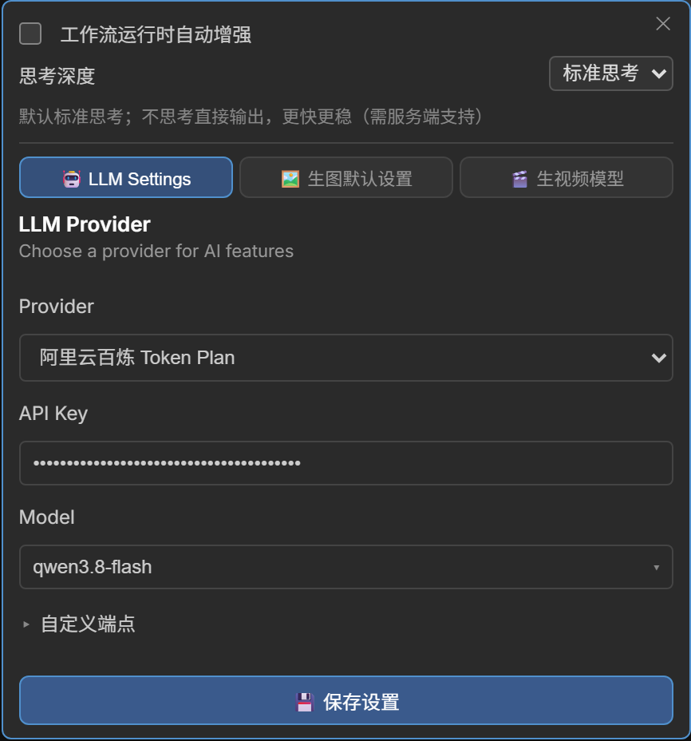

# LLM Setup & Local Inference

> 🇨🇳 中文: [../llm.md](../llm.md)

Both prompt nodes share one set of LLM runtime modes.

## LLM modes

| Mode | Description | Requirement |
|------|------|------|
| Remote | Call a cloud model through an API | Set the API Key and endpoint in the node's Settings |
| Native | Run safetensors text-generation models inside the ComfyUI process | Put the model in `models/text_encoders/`, pick "Native" as Provider |
| Local | Run inference locally with llama.cpp | Put the GGUF model in the directory and pick "Local GGUF" |



- Remote and local share the same endpoint configuration, and the sampling temperature always uses the
  server-side default.
- **Thinking models**: when you plug in a model that emits its reasoning (reasoning text arriving in
  `reasoning_content`), a "💭 Thinking…" panel appears above the prompt box during generation and clears
  itself once the answer text starts or the run ends; only the answer is kept (reasoning text is never
  written into the prompt).
- Streaming generation (remote / local / native) reserves a token budget for reasoning automatically, so
  reasoning cannot eat the whole budget and leave no answer.
- The ▾ menu next to ✨ has a "disable thinking" switch: when ticked the server is asked to skip reasoning
  and answer directly (faster and steadier, right for cases like Krea2 that only need the final prompt);
  servers that do not support the field ignore the parameter, with no side effects.

## Native engine (Native: ComfyUI safetensors)

Pick **`Native (ComfyUI safetensors)`** in Settings → Provider (the dropdown default): it reuses ComfyUI's
native text-generation path (`clip.tokenize` → `clip.generate` → `clip.decode`) and runs the safetensors
text-generation models under `models/text_encoders/` (e.g. `qwen3.5_4b_bf16.safetensors`) inside the
ComfyUI process. **No `llama-cpp-python` install needed**, and the API Key / Base URL / Models Dir rows are
hidden under this Provider.

### Models & connection test

- **Model list** - the dropdown scans every `.safetensors` under `models/text_encoders/`
  (`GET /rs_prompts/native_models`), ordered qwen3.5 series → qwen3 series → the rest; when nothing is
  stored the first entry is selected, and an empty directory makes the dropdown say where to put model
  files.
- **Connection test** - "🔌 Test connection" does not hit HTTP: it runs one short inference with the model
  in the current form (sending "hello") and returns a summary of the reply on success, proving the model
  loads and produces text.
- The model type is recognized from the weight shapes (`detect_te_model`), so no clip type has to be
  named; a pure encoder (such as `clip_l`) has no text-generation capability and fails to load.

### Generation behavior

- **Greedy by default** - `do_sample=False`, deterministic and reproducible output; the sampling parameters
  (temperature / top_k / top_p / min_p / repetition_penalty / presence_penalty / seed) are passed by the
  backend caller and are not exposed in the UI.
- **Thinking mode** - uses the native `tokenize(thinking=...)`; before a non-streaming return, the thinking
  block is stripped and only the answer is kept, never written into the prompt.
- **Pseudo-streaming** - the native engine generates the whole answer at once and cannot emit token by
  token. A streaming request runs the full generation and then forwards it in thinking / answer chunks, so
  the frontend's "💭 Thinking…" panel and the answer work as usual, just without a typewriter animation.
- **Image input** - image captioning takes only the first image, converted to an IMAGE tensor for the
  encoder; the model must be vision-capable on its own.
- **Tool-conversation fallback** - multi-turn / tool-calling (`chat_turn` + `tools`) cannot produce
  `tool_calls` on the native path, so that path falls back to the llama.cpp local backend.

### VRAM & auto-unload

- After loading, a model is cached as an in-process CLIP singleton keyed by file name and stays resident;
  the first call pays one load.
- **Auto-unload** - with "Unload the native model after this node finishes" ticked (the
  `auto_unload_native` setting), the model is unloaded and its VRAM released as soon as the node finishes
  during a workflow run.
- Switching to another Provider on save, or swapping the model in the Native slot, also unloads the old
  model and frees its VRAM.
- The native clip singleton is not concurrency-safe (`generate` rewrites the shared clip options and KV
  buffers): the engine serializes execution internally, and calls from outside the queue are serialized by
  a lock.

## Built-in cloud providers

The Settings → Provider dropdown already carries the cloud entries below. Pick one, add the API Key
(**required for cloud vendors**, an empty key returns 401) and it works — pick the model name from the
auto-listed models when possible, type it when they cannot be listed:

### Built-in providers

- **`DeepSeek`** — `https://api.deepseek.com/v1`
  signup: [platform.deepseek.com](https://platform.deepseek.com), sample model `deepseek-flash`
- **`Alibaba Cloud Bailian (Qwen)`** — `https://dashscope.aliyuncs.com/compatible-mode/v1`
  signup: [Bailian console](https://bailian.console.aliyun.com), sample model `qwen-plus`
- **`Alibaba Cloud Bailian Token Plan`** — `https://token-plan.cn-beijing.maas.aliyuncs.com/compatible-mode/v1`
  signup: Bailian console → Token Plan, sample model `qwen3.8-max`
- **`Moonshot Kimi`** — `https://api.moonshot.cn/v1`
  signup: [platform.moonshot.cn](https://platform.moonshot.cn), sample model `kimi-k3`
- **`Zhipu GLM`** — `https://open.bigmodel.cn/api/paas/v4`
  signup: [open.bigmodel.cn](https://open.bigmodel.cn), sample model `glm-5.3`
- **`SiliconFlow`** — `https://api.siliconflow.cn/v1`
  signup: [cloud.siliconflow.cn](https://cloud.siliconflow.cn), sample model `deepseek-ai/DeepSeek-V3`

### Endpoints & keys

- Take each vendor's current console list as the source of truth for model names (the table above is only
  examples): the dropdown requests the model-list endpoint automatically, reuses the stored key for
  authenticated vendors while the API Key box is empty, and refetches once you enter or change a key; when
  the list cannot be fetched it falls back to manual input.
- The Zhipu endpoint is `/api/paas/v4`, so that entry has `append_v1: false` in
  `configs/llm_providers.json`; the others end in `/v1` and keep `true` (an already-`/v1` endpoint is never
  appended twice).
- Bailian can switch to a workspace-specific domain: expand "Custom endpoint" and move the Base URL there;
  its API Key is bound to a region, and crossing regions returns 401.
- Providers with a preset Base URL keep that field inside the collapsed "Custom endpoint" area by default:
  click the title to expand it when you change the endpoint, and leave it empty to use the preset; when the
  stored endpoint differs from the preset the area **expands automatically**. Providers with no preset
  endpoint (OpenAI Compatible) keep that row always visible.
- The sampling temperature has been removed from the UI: the request body no longer sends `temperature`, and
  the server / model default is always used.
- API Key: vendors marked `requires_api_key` are **required** (saving empty warns with 401); once a key is
  stored the box shows asterisks, and leaving it untouched or clearing it both keep the old value. LM Studio
  / Ollama / vLLM / Unsloth and OpenAI Compatible may stay empty.

### The three Aliyun channels

- The three Aliyun channels are isolated from each other; API Key and Base URL must be paired, mixing them
  causes unexpected billing or 401/403: pay-as-you-go (`sk-` +
  `dashscope.aliyuncs.com/compatible-mode/v1`), Token Plan (`sk-sp-` +
  `token-plan.cn-beijing.maas.aliyuncs.com/compatible-mode/v1`, currently China North 2 (Beijing) only),
  Coding Plan (`sk-sp-` + `coding.dashscope.aliyuncs.com/v1`).
- The dropdown does **not** include Coding Plan: its terms allow interactive use inside coding tools only
  and forbid API use for automation scripts / application backends / non-interactive batch calls, and
  violating that can suspend the subscription or block the key.

The provider list is defined in `configs/llm_providers.json`; edit that file to add, remove or change
entries (including your own services), and the dropdown picks them up after a ComfyUI restart.

## Local inference services (LM Studio / Ollama / vLLM / Unsloth)

Local and LAN endpoints mostly load a model on demand when a request arrives, so the plugin does only two
things for them:

- **Model list** - local endpoints try their native endpoints first (LM Studio `/api/v1/models`, Ollama
  `/api/tags` + `/api/ps`) and fall back to the OpenAI-compatible `/v1/models` when those give nothing. The
  dropdown shows size, vision capability and the `loaded` state, and **models that are not loaded are
  selectable too**.
- **Timeout** - the effective timeout for local endpoints is raised to at least 300s (cold-loading a large
  model regularly exceeds the default 60s); public endpoints are unaffected.

**Unsloth Studio is the exception**: its `/v1/chat/completions` answers 400 while no model is loaded and
never loads one itself, and it only lets **callers that carry an API Key** trigger loading — an
unauthenticated request is skipped even with Model auto-switch on. So put a key in the plugin:

1. Create an API Key in Studio's **Settings → API** (starting with `sk-unsloth-`) and paste it into the
   plugin's Unsloth API Key box.
2. From then on, when the plugin hits that 400 it calls `POST /api/inference/load` with the key and retries
   once after loading finishes; if Model auto-switch is also on, the server cold-loads inside the first
   request. Without a key the plugin does not send that call (unauthenticated calls are refused) and the
   error tells you to create one.

The dropdown only shows "❌ cannot reach the service" when the service is unreachable; an empty list just
says "no models available".

## Installing local inference (optional)

Local GGUF mode needs `llama-cpp-python` (the native engine and remote APIs do not). It compiles from
source by default (needs a C compiler / CUDA toolchain) and fails easily on Windows, so **install a
prebuilt wheel**.

### Route 1: prebuilt wheel (recommended)

Download the wheel matching your **Python version + OS + CUDA version** from
[JamePeng/llama-cpp-python releases](https://github.com/JamePeng/llama-cpp-python/releases) and install it:

```bash

# Example: Python 3.12 + Windows + CUDA 12.4 (take the file name from the releases page)
python -m pip install llama_cpp_python-<version>+cu124-cp312-cp312-win_amd64.whl
```

CPU-only builds are on the official prebuilt index too:

```bash
python -m pip install llama-cpp-python --extra-index-url https://abetlen.github.io/llama-cpp-python/whl/cpu
```

### Route 2: compile from source

```bash

# CPU
python -m pip install llama-cpp-python

# NVIDIA GPU (needs CUDA Toolkit and a C/C++ compiler installed first)
$env:CMAKE_ARGS = "-DGGML_CUDA=ON"
python -m pip install llama-cpp-python --no-cache-dir
```

### Verification & models

```bash
python -c "from llama_cpp import Llama; print('ok')"
```

Once that passes, put the GGUF model into the model directory (layout below), pick "Local GGUF" in
Settings → Provider, select the model and click 💾 to save; when the directory holds a single model nothing
has to be switched by hand — runs use it automatically.

### Windows runtime note

A startup error like `Could not find module '...ggml.dll'` means the VC++ runtime is missing: install
[Microsoft Visual C++ 2015-2022 Redistributable (x64)](https://aka.ms/vs/17/release/vc_redist.x64.exe) and
restart ComfyUI.

## Local model directory layout

Paths follow `vendor(optional)/model name/model file(.gguf)`, for example:

```
models/LLM/
├── mradermacher/Qwen3-4B-AWQ-I4_K_M/GGUF-Q4_0-int4-v2-scratch.gguf   # a single file may also sit in the root
├── stablelm/stablelm2-1.6B.gguf                                      # a flat layout works as well
└── mradermacher/Huihui-gemma-4-E4B-it-abliterated-GGUF/
    ├── Huihui-gemma-4-E4B-it-abliterated-Q4_K_M.gguf                 # main model file (any quantization)
    └── Huihui-gemma-...mmproj-f16.gguf                               # projection file (matched automatically)
```

- **Directory location** - the **Models Dir** that appears once Settings → Provider is `Local GGUF`; empty
  means scanning `models/LLM/`, and any local path works (e.g. LM Studio's `<user>/.lmstudio/models`).
- **Model list** - every `.gguf` under that directory is found recursively, and the dropdown shows only the
  **model name** (the file name without `.gguf`); same-named files from different vendors become separate
  entries.
- **Multimodal badge** - when `mmproj-*.gguf` (or `<model name>.mmproj-f16.gguf`) sits in the model's own
  directory, a 🖼️ badge appears before the name, meaning it can be used for image captioning; with several
  candidates nothing is guessed and the slot stays empty until one matches.

Backend implementation: [architecture.md](architecture.md) (`llm.py` / `llm_providers.py`),
API: [api-routes.md](api-routes.md).
