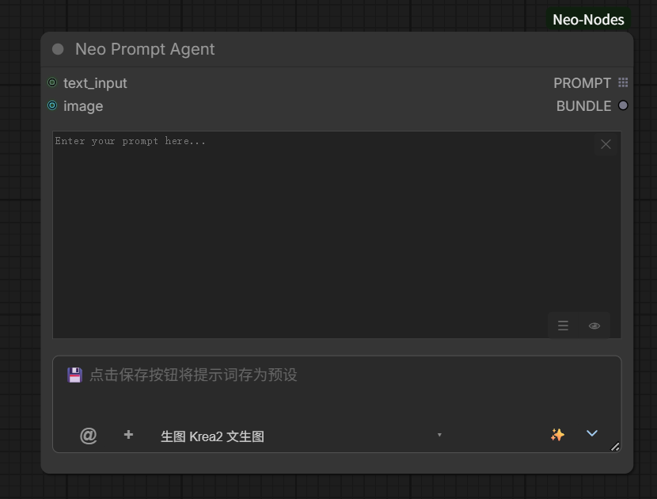
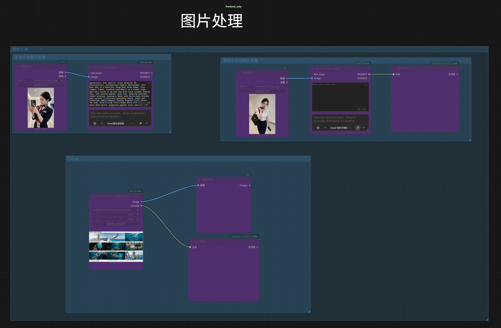

# Prompt Nodes

> 🇨🇳 中文: [../prompts.md](../prompts.md)

Covers the two prompt nodes Neo Prompt Encoder / Neo Prompt Agent, the shared interface and buttons, and
the image-captioning input. Skill management: [skills.md](skills.md). LLM modes and local setup:
[llm.md](llm.md).

## 📝 Neo Prompt Encoder - AI-driven prompt encoder

A full prompt-management + CLIP encoding node:

- **Prompt save / pick** - save and load preset prompts, presets and custom directories supported.
- **LLM prompt enhancement** - raise prompt quality with a remote API or a local LLM, with skill-template
  management and quick switching.
- **Quick generate / random generate** - type a short description and generate, or generate a creative
  prompt in one click.
- **Image to prompt** - attach a reference image (paste, drag, `@` reference to workflow images) and have
  the AI reverse a descriptive prompt from it.
- **Classify / title extraction** - when saving a preset, the AI classifies the content and extracts a
  title, so one click saves a prompt or a recipe.
- **Skill system** - call different capabilities through the skill picker, grouped: image prompt
  enhancement and video prompt enhancement (generator / omni reference) first, then image / reverse,
  direct generation or editing, custom; the video-generation (H3) and task skills are internal and are
  not listed.

### Inputs / Outputs

| Input | Type | Description |
|------|------|------|
| `clip` | CLIP | Text encoder (required) |
| `text_input` | STRING (forceInput) | External text input |
| `image` | IMAGE | Reference image (for image-to-prompt) |

| Output | Type | Description |
|------|------|------|
| `POSITIVE` | CONDITIONING | Positive encoded conditioning |
| `PROMPT` | STRING | Final prompt text |

## ⚡ Neo Prompt Agent - minimal prompt agent

A lightweight prompt-generation node for the cases that only use the generated prompt text and need no
CLIP encoding:

- **No CLIP input** - not bound to a text encoder.
- **No status bar / toggles** - a simpler interface.
- **Outputs PROMPT + BUNDLE** - PROMPT is the prompt text; BUNDLE is this run's runtime package id,
  consumed by id in 🎨 Krea2 / 🎬 H3 (it carries the prompt and the reference images, not the skill).
- **The skill dropdown lists only skills without a `workflow.json`** - a skill that ships a workflow is
  driven by `workflow.json`, its body text does not participate in this node, so it is not listed here.

### Inputs / Outputs

| Input | Type | Description |
|------|------|------|
| `prompt` | STRING (hidden) | Prompt text (hidden) |
| `instance_uid` | STRING (hidden) | Instance id (hidden) |

| Output | Type | Description |
|------|------|------|
| `PROMPT` | STRING | Prompt string (multi-result skills consume it entry by entry) |
| `BUNDLE` | STRING | Runtime bundle id (`bnd_*`), see below |

- Connect `BUNDLE` to the `bundle` input of 🎨 Krea2 / 🎬 H3 to carry the prompt and the reference images
  in one go (wire / `@` reference / local upload), without the skill.
- A bundle lives in memory only; once it expires, downstream safely falls back to its local inputs.

## 📦 Neo Bundle Expand - expand a BUNDLE

Expands the **BUNDLE** from ⚡ Neo Prompt Agent into standard input slots, aligned with the official
MiniMax H3 Reference to Video `ref_images` (up to 9):

- **Output slots grow** - only `prompt` + `image_1` are shown by default; connecting the last visible
  image slot reveals the next one, up to 9.
- After a run the node shows the prompt and a thumbnail grid of the reference images in output order
  (read-only). Video and audio references are not expanded.

| Input | Type | Description |
|------|------|------|
| `bundle` | STRING (forceInput) | The BUNDLE output of ⚡ Neo Prompt Agent |

| Output | Type | Description |
|------|------|------|
| `prompt` | STRING | The prompt text inside the bundle |
| `image_1..image_9` | IMAGE | Reference images (up to 9, revealed as slots grow) |

## 🔲 Neo Reference Grid - reference-image grid node

Prompt + up to 12 reference images in a single node:

- **Grid slots (1~12)** - the toolbar −/+ adjusts the slot count at runtime (default 9, not saved with
  the workflow; it grows automatically when more images arrive). Drag in from the asset panel / add
  locally in batches (multi-select) / drag OS files straight onto the grid; tiles are
  drag-reorderable, removable with ✕, clickable for a preview.
- **Load recipe** - the toolbar ☰ opens a picker listing only plain recipes that contain images
  (multi-segment director recipes and image-less recipes are excluded); clicking loads the images
  (≤12) and the prompt into the grid.
- **Width-driven flow layout** - columns follow the node width (minimum card width 84px), card aspect
  follows the image's real ratio (whole image visible, never cropped); the node height follows the
  content.
- **Output slots grow** - `prompt` / `BUNDLE` / `image_1` by default, slots reveal up to `image_12` as
  you connect them; after a run the node shows how many reference images were actually used and their
  source order (cell N).
- **Recipe integration** - when a recipe is saved, the grid images are collected as the **primary image
  assets** (ahead of wired LoadImage nodes); on restore they fill the grid first (≤12) and the rest goes
  into LoadImage; when a sub-graph has no Neo Prompt node, the prompt falls back into the grid's prompt box.

No visible inputs (only the hidden `refs` / `prompt_text`).

| Output | Type | Description |
|------|------|------|
| `prompt` | STRING | The content of the node's prompt box |
| `BUNDLE` | STRING | Runtime package id; connect straight to 🎨 Krea2 / 🎬 H3, or expand it with 📦 Neo Bundle Expand |
| `image_1..image_12` | IMAGE | Reference images in grid-slot order; a broken file keeps its slot empty instead of shifting the rest |

## Node interface & buttons

Both nodes share the same layout (the Agent shows no status bar):

| Control | Position | Function |
|------|------|------|
| LOCAL / EXTERNAL | Top status bar | Switch between local prompt / external text_input (shown automatically once connected) |
| 🎲 | Bottom-right of the text area | Generate a random creative prompt |
| ☰ | Bottom-right of the text area | Open the preset list (search, delete, category tab filtering) |
| 💾 | Bottom-right of the text area | Save the current prompt or recipe as a preset; the AI extracts the title and category tags |
| 👁 | Bottom-right of the text area | Markdown preview toggle (see below) |
| ✕ | Top-right of the text area | Clear the current prompt in one click, synced to the widget and local storage |
| ＋ | Bottom input bar | Attach a reference image (captioning / multimodal skills); paste, drag and `@` reference supported |
| Skill picker | Bottom input bar | Pick the skill used for this generation ([skills.md](skills.md)) |
| Auto generate ☐ | Bottom input bar | When ticked, running the workflow performs the generation and writes the result back live |
| ✨ | Bottom input bar | Generate a prompt from the quick-input description |

- **Markdown preview (👁)** - when the generated result is recognized as Markdown (headings / code blocks
  / lists and the like) it switches to a typeset preview automatically; 👁 toggles manually between
  preview and raw editing; streaming output renders live; task-list checkboxes (`- [ ]`) are clickable
  directly, and the choice is written back into the text and carried into the next generation. Clearing
  the prompt clears the preview too.
- **Category tabs** - the three tabs under the preset list's search box: image / video / recipe. Image is
  everything except `presets/video/`, video is the prompts under `presets/video/`, recipe is the plain
  recipes. Image is selected by default, and the choice is stored in frontend local storage for the next
  opening.
- **Skill picker** - pick the skill for this generation: image / reverse, task, style template, custom;
  hovering a row shows a floating preview card (generation skills = configuration summary, the rest = an
  excerpt of the skill.md body), clicking the card opens the detail window; + New Skill / ⬆ ZIP /
  ⬆ Folder at the bottom of the dropdown are the skill-management entries.
- **Multi-turn skills** - when a skill that declares `multi_turn` is selected, a line of small text
  appears at the very bottom of the node (it hides again when the skill is switched or cleared): each
  generation advances one stage only, so fill in the returned questions completely and click ✨ again to
  continue to the next stage.
- **Quick-input history** - the bottom quick-input bar supports terminal-style ↑/↓ recall of earlier
  inputs (locally persisted, deduplicated, newest first, capped at 20); editing the text leaves
  navigation mode, and both node types share one history.

## Skill management

Skill composition, the skill manager window, the embedded workflow editor, skill ⇄ canvas import and
writeback, writeback confirmation and change history: [skills.md](skills.md).

The skill picker at the bottom of the node groups the selectable skills by purpose: 🖼️ image / reverse,
🎨 style template, 📝 custom (the video-generation H3 skills and task skills are internal and are not
listed). A 📷 prefix on an option means that skill needs image input.

## Image captioning & image input

When a 📷 image / reverse skill is selected, reference images can be supplied in these ways:

| Method | Action | Description |
|------|------|------|
| ＋ button | Click the ＋ next to the input box | Pick a local image through the file picker |
| Clipboard paste | `Ctrl+V` | Converted to base64 automatically and turned into a thumbnail chip |
| Drag import | Drag a local image into the quick-input box | Read automatically and turned into a thumbnail chip |
| `@` reference | Type `@` in the input box | Lists every Load Image node image available in the current workflow |

Asset integration: "Copy to Input" in the gallery puts the image into ComfyUI's `input` directory, so a
Load Image node in the workflow can pick it up and the `@` picker can reference it for captioning; the
lightbox's send button can also write the information attached to an image straight back into a Neo
Prompt node.

### `@` image references

Typing `@` anywhere in the quick-input box opens the image picker, positioned next to the cursor:

- **Image sources** - scans every Load Image style node (variants included) in the current workflow,
  skipping BYPASS / disabled nodes.
- **Entry badges** - `#N`: this image is already wired into this node's IMAGE input slot, `N` being the
  parameter position number, and inserting it produces a `<Picture N>` marker at the `@`;
  `✓`: not wired but already attached for captioning; no badge: an unwired image, clicking only attaches
  it for captioning and takes no `<Picture N>` number.
- **Keyboard** - `↑`/`↓` move the highlight, `Home`/`End` jump to the ends, `Enter` inserts the selection,
  `Esc` closes; deleting the `@` closes the popup automatically.
- **Dedup & numbering** - the same image is never attached twice; numbering follows the parameter order of
  the workflow's Load Image nodes and stays consistent with the number badge on the thumbnail chip.

**Thumbnail chips & image markers**

- Attached images appear as thumbnail chips above the quick-input box; hovering enlarges the original,
  ✕ removes it.
- A chip with an `N` badge corresponds to the `<Picture N>` marker in the body text, used to describe the
  interaction between images.
- A chip without a number is only sent along as a captioning attachment.

### `/` skill quick menu

Typing `/` in the quick-input box opens the skill quick menu below the input, filtered live as you keep
typing (by skill name / id / tags, case-insensitive; Chinese skill names match on full pinyin and on
initials):

- **Filtering** - every keystroke refilters; an empty query lists all skills sorted by category; the
  popup closes when the query contains whitespace or the `/` is deleted. Chinese skills accept pinyin
  (`dmfg` / `dongman` hits 「动漫风格」).
- **Rows** - each row shows the skill name (📷 badge when images are required) and its category name; the
  internal id is not shown.
- **Keyboard** - `↑`/`↓` move the highlight, `Home`/`End` jump to the ends, `Enter` or `Tab` commits the
  highlighted row, `Esc` closes; filtering never auto-commits, a key press is always required.
- **Commit effect** - the selected skill is written into the node's bottom skill dropdown (equivalent to
  picking it by hand), the `/xxx` prefix is cleared from the input, and focus stays in the input box.

Good for keyboard-only skill switching: type `/` plus a name fragment, arrow to the row, Enter.

Backend implementation: [architecture.md](architecture.md) (`prompt_agent.py` / `prompt_encoder.py`),
API: [api-routes.md](api-routes.md).
