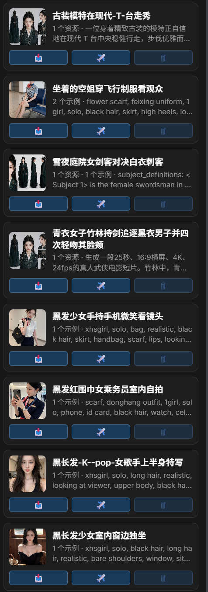
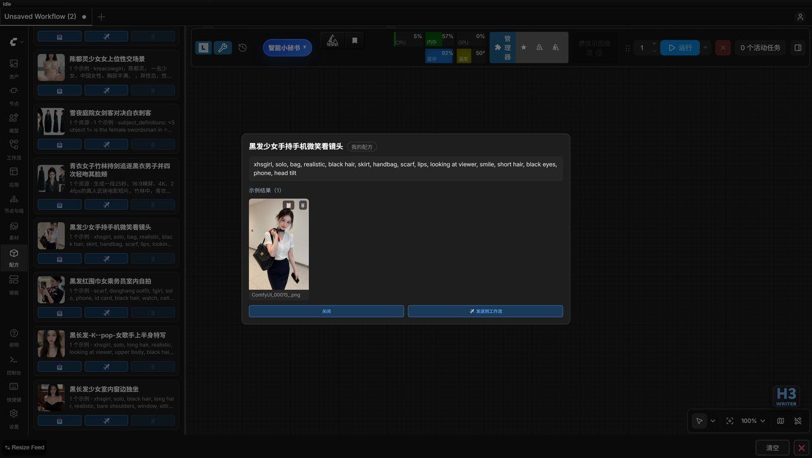
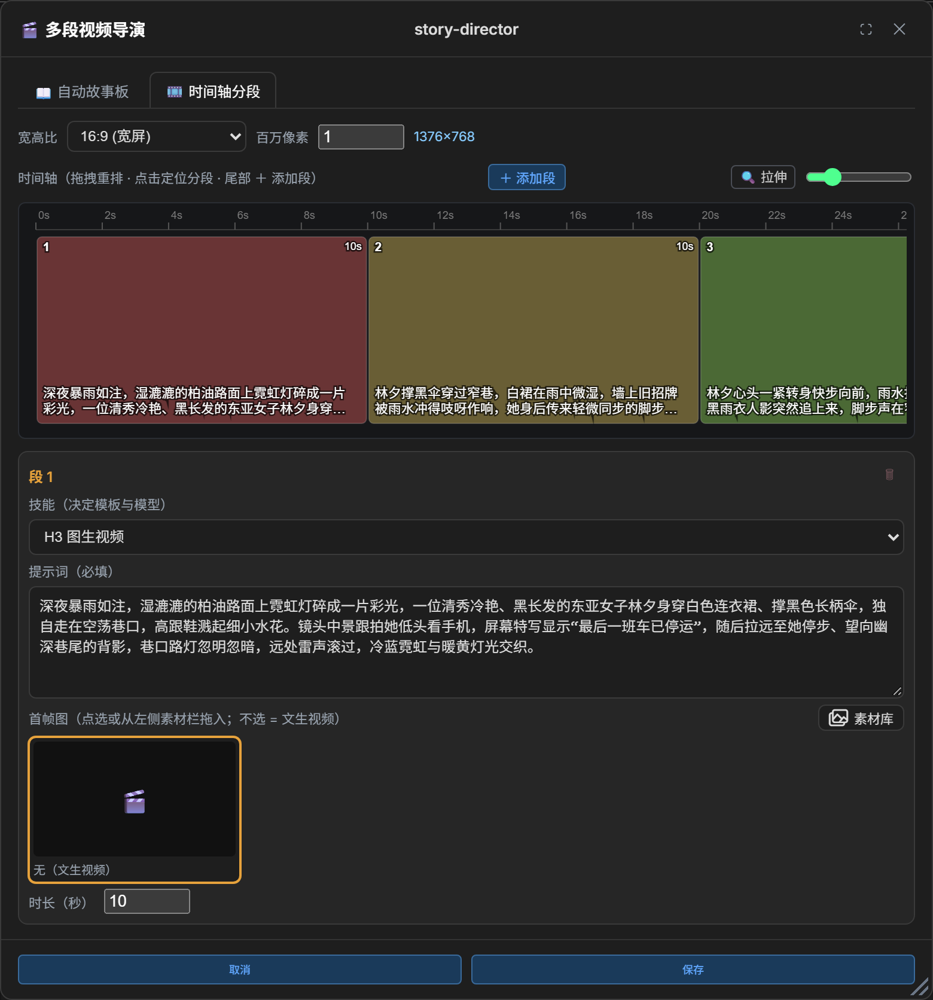
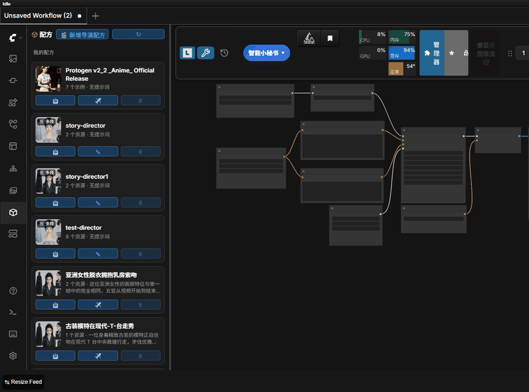
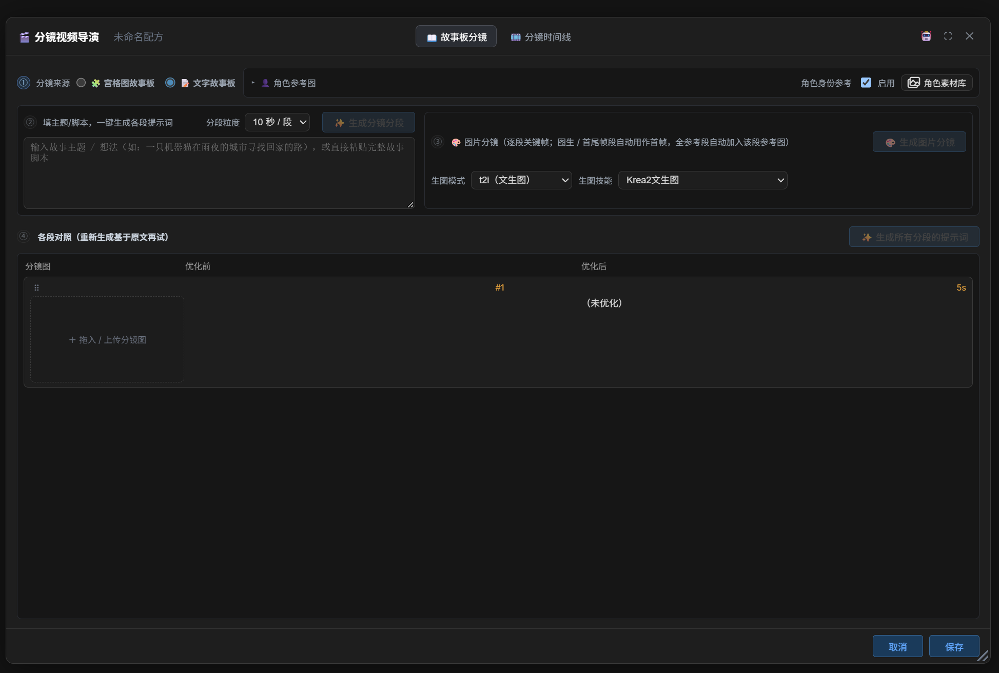
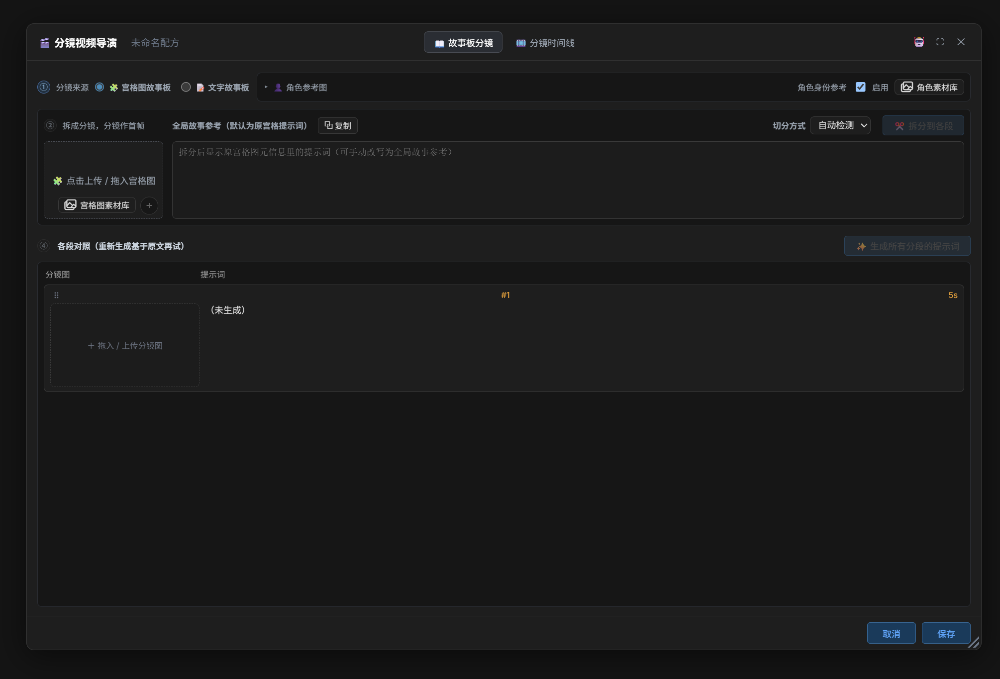

# Recipes

> 🇨🇳 中文: [../recipes.md](../recipes.md)

A recipe combines a prompt with a set of input resources (images / videos / audios) so multi-reference
workflows can be reused. Recipes live in two directories, **custom (saved by the user)** and **presets
(built-in, read-only)**, and each recipe is a folder:

```
recipes/
├── custom/                  # recipes saved by the user (deletable)
│   └── <recipe name>/
│       ├── recipe.json      # metadata: name / prompt / assets / kinds / results …
│       ├── assets/          # input resources (may be empty for a text-to-image recipe)
│       ├── samples/         # sample results (used for the cover and previews)
│       └── workflows/       # workflow backups matching those samples
└── presets/                 # built-in preset recipes (read-only)
    └── <recipe name>/
        ├── recipe.json
        └── assets/
```

## Saving a recipe

- Click 💾 in a Neo Prompt node; the bottom of the dialog offers "Save prompt" and "🧊 Save recipe".
- After you confirm the name, it collects the wired `LoadImage` / `LoadVideo` / `LoadAudio` inside the
**connected sub-graph of that node**, together with that node's prompt, and saves into `recipes/custom/`
(a name that collides with a built-in preset is rejected); the dialog shows live how many resources will be
collected.
- Images inside a 🔲 NeoRefGrid grid are collected as the **primary image assets** (ahead of the wired
LoadImage nodes); the grid toolbar's 💾 saves a recipe straight from "grid prompt + grid images".
- With "**also save the results**" ticked (ticked by default), the most recent execution output is stored as
a **sample result** in `samples/`: the output type is decided by the output nodes, content is deduplicated,
repeated saves accumulate, and a full workflow snapshot is backed up into `workflows/`.

## Recipe panel

- The sidebar's "Recipes" page groups entries into "My recipes / Built-in presets"; 🗑 deletes custom recipes
only, ⧉ copies one into a new copy (auto-named `<name>-copy`, with `-2/-3` on collision; a preset can be
copied into custom too).
- The header toolbar supports **search** (name / prompt), **filter** (all / plain / multi-segment / mine /
presets) and **sort** (recently modified / name / with results first); group headers collapse, and the state
and scroll position persist with the panel.
- Clicking a thumbnail or title opens the detail overlay: the full prompt, every resource (videos preview,
audios play), the sample results, and direct send-to-workflow.
- A multi-segment director recipe card shows a summary line (segment count · mode · skills ×N · width×height
· total duration).
- Card covers and the detail grid use thumbnails (lazy-loaded, falling back to the original when generation
fails).
- The preset list on a node merges recipe entries as well; clicking refills the prompt and restores the
resources into the surrounding sub-graph.



## One-click send to workflow

Clicking ✈️ on a recipe card (or send inside the detail overlay) copies the resources into ComfyUI's
`input/` and restores the prompt and resources into the matching **connected sub-graph**.

### Sub-graph matching & alignment

- The target sub-graph is picked automatically by exact matching, where the resource counts equal the wired
loader counts type by type; when the canvas holds a single sub-graph it is used directly; with several
candidates or no match a dropdown asks you to pick (cancelling changes nothing).
- When the asset count and the count of enabled wired nodes disagree, they align automatically: too many
assets enable Bypass / Never nodes to fill the slots, too few set the surplus enabled nodes to Bypass;
whatever cannot fit is reported as "only partially restored".
- When the sub-graph contains a NeoRefGrid, **the grid is filled first** (up to 12 image assets into its
slots) and the remaining images go into LoadImage by parameter position; the prompt goes into Neo Prompt, and
when the sub-graph has no Neo Prompt it falls back into the grid's prompt box.
- Sending a recipe chosen directly on a Neo Prompt node targets that node's sub-graph with the same automatic
alignment, with no dialogs at all.



### Sample results & product records

- **📥 Append results**: appends the current workflow's most recent execution output as sample results of this
  recipe (deduplicated, accumulating across runs, with the workflow backed up).
- **📋 Copy workflow**: copies a sample's workflow snapshot back onto the current canvas.
- Sample results are deletable one by one; deleting the last sample that references a workflow cleans up that
  orphaned workflow backup too.
- **Results** are something else: only the **paths** of execution products under `output/` are recorded in
  `recipe.json`, no files are copied. The multi-segment director node records automatically when it finishes
  (bundle single-segment mode has no recipe, and preset recipes are read-only, so neither records).
  The "Results (N)" area of the detail overlay loads thumbnails through ComfyUI's native `/view`, and clicking
  opens the Lightbox; 🗑 asks for confirmation and then deletes the real product from disk (with its `.txt`
  sidecar) and removes the record.
  Files deleted by hand stop being listed, and re-saving the recipe does not clear the result records.

## Storyboard video director recipe (video_director)

A plain recipe is "one prompt + a set of resources"; a `video_director` recipe is a **multi-segment structured
container**: one segment = one H3 video generation task (its own skill / prompt / duration / first frame), and
the `NeoH3VideoDirector` node generates them in order and concatenates them into a single `VIDEO` with audio.
Execution details: [h3-video-gen.md](h3-video-gen.md).





### Entry points

- **🎬 New director recipe** in the header of the sidebar's "Recipes" page creates one.
- An existing director recipe: click its card thumbnail to enter the editor, or click a timeline segment block
  / the ✎ in the top-right of a `NeoH3VideoDirector` node (entering through a block positions the editor on
  that segment; when the window is already open, clicking another block only switches the current segment).
- Desktop Studio director page: clicking a left-column recipe card selects it and opens it embedded in the
  top-right pane (the card's ✎ works too).
- The **＋** in the bottom-right outside the node's timeline display opens the create editor directly (after
  saving, the recipe is added to the `recipe` dropdown and selected).
- **Run only the checked segments**: hovering a timeline segment block reveals a checkbox, and checking some
  makes this run generate only those; segment numbers and seeds keep the recipe's original numbering, and the
  checks are a runtime state that is never written into the recipe.

### Editor interface

#### Resolution & mode

- **Shared resolution**: aspect ratio + megapixels (0.1–2, one decimal) → width / height (aligned to 32);
  "Custom" lets you type W/H. A new recipe starts at 16:9 @ 0.5 MP = 960×544.
  When a first frame is already prefilled, or a LoadImage is wired on the canvas, the aspect ratio snaps to
  the preset ratio closest to the first-frame image (only the ratio dropdown moves; megapixels and typed
  values are untouched). After a grid split the shared ratio snaps to the closest preset for the first frame
  as well. On save, segments whose first-frame ratios disagree trigger a non-blocking warning.
- **Film run parameters** (behind the **Advanced** checkbox at the end of the first row of the
  "🎞️ Storyboard timeline" page, collapsed by default, saved into `shared`):
  - **Seed**: empty = `-1`, a fresh random seed on every run; each segment's seed = this seed + its original
    segment index. An explicit value on the node's `seed` input overrides it.
  - **Steps**: empty = `-1`, each segment uses its own skill config's steps; a typed value (≤100) applies that
    step count to the whole film.
  - **Continuity** (on by default): the tail of the previous segment becomes the regeneration window at the start
    of the next one, and character identity references are inherited.
  - **Context frames** (shown only while continuity is on): the context window frame count; 0 = fall back to
    last-frame chaining (only the previous segment's last frame, no regeneration window).
  Recipes missing these keys keep the original defaults (skill-config steps, continuity on, 22 context frames).
- **Generation mode & skill**: the first row of the "🎞️ Storyboard timeline" page holds the global generation
  mode dropdown (storyboard to video / full-reference video / mixed) and the unified "skill" picker (clicking
  opens a centered search window, options filtered by the global mode, sorted by ascending steps). In
  non-mixed modes all segments share that skill and the per-segment skill dropdown in the segment title row is
  hidden; switching to `mixed` moves mode and skill to per-segment selection. The default skill of a new
  recipe is the first list entry, skipping unavailable skills.

#### Section visibility & validation

- **Section visibility**:
  - First-frame area (`f2v`): a single-select thumbnail grid; pick a LoadImage wired on the canvas, or drag
    from the asset panel on the left (in desktop Studio: the asset library the director page's left column
    switches to); clicking the selected image again clears it.
  - Last-frame area (`f2v`): an identical independent grid; under `fl2v` the first- and last-frame areas sit
    side by side in one row.
  - Reference media area (`r2v`): three used-lists (reference images ≤9 / reference videos ≤3 / reference
    audios ≤3); drag in, or click an empty area to upload, and it inserts — only its own media type is
    accepted, order is drag-adjustable, and the limit is refused with a message. The title row's
    "📋 Sync to all segments" overwrites every other segment's media with the current segment's.
  - The first-/last-frame area title rows have a "📤 Local" button (file picker filtered by type, uploaded to
    `input/` and selected automatically).
- **Save validation**: image-to-video and first-last-frame segments need a first frame, last-frame generation
  needs a last frame, full-reference segments need reference media; when something is missing a warning shows
  and the content is saved anyway (a draft can be finished later), and execution reports it clearly. Older
  recipes without a global mode infer it from each segment's content.

#### Window & editing state

- **Window**: 1280×840 by default (on short screens the height follows 88vh); the title bar drags, the
  bottom-right handle resizes; **⛶** maximizes to the largest size in one click, clicking again or
  double-clicking the title bar restores. When the window is tall, the story topic / script input area and the
  current segment's prompt area fill the available height.
- **Embedded in desktop Studio**: the Studio director page lays the editor out directly inside the top-right
  pane (the recipe list stays in the left column, the generation panel below), with no overlay window — no
  title-bar dragging, no **⛶** maximize, no resize handle; close with the title-bar **✕**. The footer gains
  **🎬 Save & Generate Film**: it runs the full save path and, on success, submits the film with the parameters
  just saved into the recipe plus the segments checked in the generation panel. An embedded save leaves the
  editor open (the film runs in the pane below); closing is the **✕**, **Cancel**, or the dirty bar's
  "Save & close". With no editor open the top-right pane takes no space and the generation panel fills the
  column. See [studio-desktop.md](studio-desktop.md).
- **🤖 LLM config** on the right of the title bar opens the embedded LLM configuration form (values are
  backfilled in the background on open, 💾 writes them out).
- The **recipe name** shows in the middle of the title bar; clicking turns it into inline input, Enter or blur
  commits, Esc restores; for a new recipe the title follows the topic or segment prompt live (truncated past
  20 characters), and stops being overwritten once you name it.
- **The editor is a singleton**: clicking the same recipe while it is open is ignored; clicking another closes
  the old window and loads that recipe.
- **Unsaved-change protection**: any action that would change what gets written marks "unsaved changes";
  clicking ✕ / cancel / switching recipes then shows a confirmation bar: **💾 Save & close** / **Discard** /
  **Keep editing**.
- The editing panel has no overlay and does not dim the background, so you can keep dragging images from the
  left asset panel into a specific segment while editing.

### Timeline overview

#### Segment blocks

- The top of the panel is the reusable timeline component, drawing segment blocks to the proportions of each
  `duration_sec` plus a seconds ruler.
- Each block shows its index (top-left) and duration (top-right), with a prompt summary at the bottom (the
  visual description only, at most two lines).
- A block with a first-frame reference image tiles it to fill the block; a reference-based segment tiles each
  of its reference images side by side.
- Clicking a block positions and focuses the matching segment card; when the current segment changes, the
  timeline scrolls that block into view.

#### Drag & zoom

- Drag a block to reorder segments (the source follows the cursor as a ghost block, the landing slot shows a
  dashed frame, the other blocks move aside live); drag a block's right edge to change its duration; the
  trailing ＋ appends a segment.
- The **↔ stretch** control at the right end of the hint row (button + slider 0.25–4×): scales the timeline
  width, a horizontal scrollbar appears when it exceeds the viewport, and the wheel scrolls horizontally.
- By default each segment is about one 16:9 video frame wide, with the width inside a segment distributed by
  duration; when the default total width exceeds the viewport it scrolls horizontally.
- The timeline component takes its data from the host and is driven by callbacks, so it can also be mounted
  inside a `NeoH3VideoDirector` node (read-only preview there, no ＋).

### Storyboard page

The editor's title bar carries two tabs: **📖 Storyboard** (character references / storyboard source /
per-segment comparison) and **🎞️ Storyboard timeline** (generation mode / unified skill / chunk seconds +
shared resolution + timeline + per-segment cards). On open it returns to the tab this recipe was last on; with
no memory it opens on the timeline page — a single-segment recipe (one image-to-video or full-reference clip) is
just a timeline plus one prompt box. A blank new recipe shows a one-line guide at the top of the timeline page
("split a theme or a grid sheet into several segments? → 📖 Storyboard") that switches tabs and disappears once a
second segment exists.

**A single-segment recipe only shows what one segment needs**: with one segment, "chunk seconds" is hidden (there
is no second segment to merge) and the Storyboard page replaces the per-segment comparison table and its batch
optimize button with a one-line hint (write the prompt at the bottom of the timeline page). Both come back as soon
as a second segment exists.

This page is laid out **① source / character media → ② segments → ③ keyframes → ④ prompts**, each step's title
row carrying an index badge on the left (✓ done / highlighted your turn / dimmed a prerequisite is missing),
each step having a single action button placed uniformly in the top-right of its title row, greyed out with a
hover hint naming what is missing.

#### Source & character media

- **Storyboard source (pick one)**: 🧩 grid-image storyboard / 📝 text storyboard; only the selected source's
  card is shown.
- **👤 Character reference images**: a recipe-level permanent card (present under both sources), shared by
  text-storyboard generation, r2i image storyboards and the identity reference of every video segment. The
  rightmost control on that row is the **character identity reference** switch (on by default; unchecking
  writes `shared.identity_refs=false` on save).
- **📝 Text storyboard**: left column story topic / script + segment granularity (5 / 10 / 15 seconds) + ✨
  Generate storyboard segments; right column 🎨 image storyboard cards. After you click generate, the LLM
  outputs the segment JSON directly (per segment `prompt` / `duration_sec` / `storyboard_prompt`, with the
  character reference images attached multimodally to lock identity), and on success it replaces the timeline's
  existing segments (the skill becomes the first available video skill, each segment's `mode` is `t2v`). When
  an older recipe opens, the topic box shows `story.idea`.



- **🧩 Grid-image storyboard**: pick an existing storyboard grid image (produced externally, uploaded locally
  or dragged from the asset library), the split method (auto-detect / manual rows×columns) + ✂️ Split into
  segments. Each cell becomes that segment's first frame and storyboard image (`i2v`) and replaces the existing
  segments. To the right of the source image sits the "global story reference (the source image's embedded
  ComfyUI metadata by default)", extracted from it, editable and copyable.



#### Keyframes & prompts

- **🎨 Image storyboard (keyframes)**: generation mode t2i text-to-image / r2i reference editing (default
  follows the character references: images present → r2i, none → t2i) + generation skill (t2i defaults to Krea2
  text-to-image, r2i to Qwen Image 2.1, each mode remembering its last choice) + 🎨 Generate storyboard images.
  - Keyframes are generated segment by segment in sequence, all segments of one run sharing the same seed (the
    prompts stay per-segment); clicking again forces a full regeneration.
  - Keyframes land in the recipe's own `assets/storyboard_<recipe>_<segment>.png`, never through `input/`.
  - When generation finishes they are routed by each segment's effective mode: image-to-video and
    first-last-frame segments take it as their first frame; full-reference segments add it to that segment's
    reference pool automatically (deduplicated, within the ≤9 limit); mixed mode routes per segment mode.
  - **The prompt used for a storyboard image is the `storyboard_prompt` produced at split time (a static frame,
    no camera movement), not the video segment prompt**; older recipes without that field fall back to the video
    prompt and name it in that segment's `warnings`.
- **Per-segment comparison**: "✨ Generate prompts for all segments" calls the LLM per segment and rewrites each
  into a finished prompt following the MiniMax H3 audit specification; SSE streams it token by token back into
  that segment and refreshes the table live, and one failing segment does not stop the rest. The list has three
  columns (left = storyboard image, middle = original before optimization, right = the latest optimization
  result), and the ⠿ handle in the row header reorders rows and writes the order back to the timeline. A
  permanent empty-segment placeholder row sits at the end: only dropping a storyboard image into that row, or
  uploading there, actually creates a segment. Under grid-split mode the segments have no original text, so the
  table drops to two columns and generate describes each cell's storyboard image (segments without one are
  skipped). Re-running optimization always retries from the text before the first optimization, never stacking
  on the previous result.

#### Media & state

- **Unified media area**: shown or hidden by the global generation mode. Full-reference mode points you to the
  timeline page to set each segment; text-to-video / mixed modes show explanatory text.
- **State saved with the recipe**: topic / segment granularity / character references / image-storyboard mode,
  skill and source are written into `story`; the before/after prompt comparison is written into `setup` (for
  display only; execution reads each segment's own fields).

### Schema

| Field | Description |
|------|------|
| `type` | `"video_director"`; older flat recipes without the field behave exactly as before |
| `shared` | Shared settings: width/height / ratio / megapixels / mode / identity references / chunk seconds |
| `segments[]` | Per segment: skill / prompt / duration / first frame / last frame / mode / reference media |
| `story` | Storyboard content: topic / segment granularity / character references / image-storyboard mode, skill, source |
| `setup` | Before/after prompt comparison (for display only) |

- `shared.mode` is `f2v` / `r2v` / `mixed`; when absent it is inferred from each segment's content.
- `chunk_sec` is the multi-frame single-run chunk length in seconds (`0` = no merging, default 15).
- A segment's `mode` is written per segment only in mixed mode, and is `t2v` / `i2v` / `fl2v` / `r2v`.
- A segment's `refs` is `{images[≤9], videos[≤3], audios[≤3]}`, written only when reference media is attached.
- `first_frame` / `last_frame` / `refs.*` reference file names inside the recipe's own `assets/`; on save the
  backend maps the original names to the final landed names and writes them back, and referencing an asset that
  was never saved is rejected.

## Import / export

- **⬇️** on a recipe card exports the whole recipe directory as a zip (top-level directory = recipe name), with
  a **Readme.txt** inside: an overview of the package plus a three-step quick start (install the plugin → 📦
  Import this zip → director recipes run from the node's selection, plain recipes send to the workflow with ✈️).
  Language: Chinese / English, forced by the remote configuration's `readme_language` (`cn` / `en`); the default
  `auto` decides from the recipe name and prompt.
- **📦 Import** in the header of the sidebar's "Recipes" page picks a zip to upload: it must contain
  `recipe.json` (at the root, or under a single top-level directory), path-traversal entries are rejected, a
  name colliding with an existing recipe becomes `-copy/-2/…` automatically, and it lands in `recipes/custom/`.

## Implementation notes (developers)

### Resource collection & encoding

- Saving a recipe collects per **connected sub-graph**: only `LoadImage` / `LoadVideo` / `LoadAudio` whose output
  is wired, ordered by parameter index (image groups first, then video and audio groups); unwired nodes, nodes
  in other sub-graphs and disabled nodes (BYPASS / NEVER) take no part.
- The resource type is decided by the **loader node type** and recorded in the `kinds` map of `recipe.json`; the
  same mp4 can serve as video or as audio input, so the extension is never reverse-inferred, and only files
  placed into `assets/` by hand fall back to extension-based detection.

### One-click send & sub-graph alignment

- Assets and prompt are written into one single sub-graph, paired by **the parameter positions at save time**.
- When there are more assets than slots, wired Bypass / Never nodes are enabled by parameter position to fill
  them; when there are fewer and every enabled node of that type feeds the same downstream target, the surplus
  enabled nodes are set to Bypass (the earlier parameter positions keep participating).

Backend implementation: [architecture.md](architecture.md) (`recipes.py`), API: [api-routes.md](api-routes.md).
